### 1 - Konfigurasi Jaringan Dasar Jujutsu High

> Ketika Curtain menutup Shibuya, jalur komunikasi antar zona Jujutsu High terputus. Pulihkan konektivitas dasar dengan mengonfigurasi jichi: eth0 memperoleh WAN dari NAT, sedangkan eth1–eth4 menjadi gateway Network 1–4 sesuai tabel pemetaan. Aktifkan IPv4 forwarding dan source NAT, lalu tetapkan IP statis host infrastruktur sesuai tabel spesifikasi. Buktikan konektivitas setiap host ke gateway dan akses eksternal dari host yang relevan.

Soal 1 meminta konfigurasi fondasi jaringan Jujutsu High secara menyeluruh. `jichi` sebagai router utama harus mampu menghubungkan keempat jaringan internal sekaligus membuka akses ke internet melalui NAT. Selain itu, seluruh host infrastruktur di Network 1 dan Network 4 harus memiliki alamat IP statis yang tetap agar layanan-layanan berikutnya seperti DNS, DHCP, load balancer, dan database dapat ditemukan di alamat yang tidak berubah. Konektivitas dibuktikan melalui ping dari setiap host ke gateway masing-masing serta ke internet publik, memastikan bahwa forwarding dan NAT di `jichi` berjalan sebelum soal-soal selanjutnya dikerjakan.

Sebagai router utama yang menghubungkan seluruh zona jaringan Jujutsu High, `jichi` dikonfigurasi dengan lima antarmuka. `eth0` memperoleh alamat WAN secara dinamis dari NAT, sedangkan `eth1` hingga `eth4` masing-masing menjadi gateway untuk Network 1 hingga Network 4.


Gambar di atas merupakan gambaran topologi jaringan Jujutsu High.

Berikut adalah konfigurasi antarmuka pada `jichi` yang disimpan di `/etc/network/interfaces`:

#### jichi (Router Utama)

```
auto lo
iface lo inet loopback

auto eth0
iface eth0 inet dhcp
    post-up echo "nameserver 192.168.122.1" > /etc/resolv.conf
    post-up sysctl -w net.ipv4.ip_forward=1
    post-up iptables -t nat -C POSTROUTING -o eth0 -s 192.214.0.0/16 -j MASQUERADE || iptables -t nat -A POSTROUTING -o eth0 -s 192.214.0.0/16 -j MASQUERADE

auto eth1
iface eth1 inet static
    address 192.214.1.1
    netmask 255.255.255.0

auto eth2
iface eth2 inet static
    address 192.214.2.1
    netmask 255.255.255.0

auto eth3
iface eth3 inet static
    address 192.214.3.1
    netmask 255.255.255.0

auto eth4
iface eth4 inet static
    address 192.214.4.1
    netmask 255.255.255.0
```

IPv4 forwarding diaktifkan agar `jichi` bersedia meneruskan paket antar jaringan. Aturan Source NAT (MASQUERADE) ditambahkan pada `eth0` sehingga seluruh alamat internal `192.214.0.0/16` dapat menjangkau internet publik menggunakan IP WAN `jichi`. Kedua konfigurasi ini ditulis sebagai `post-up` pada blok `eth0` agar otomatis aktif setiap kali node dinyalakan.


Selanjutnya, seluruh host infrastruktur di Network 1 (DMZ) dan Network 4 (Data Center) dikonfigurasi dengan alamat IP statis. Berikut konfigurasi masing-masing node:

#### Utahime

```
auto eth0
iface eth0 inet static
    address 192.214.1.2
    netmask 255.255.255.0
    gateway 192.214.1.1
    post-up echo "nameserver 192.168.122.1" > /etc/resolv.conf
```

#### Shoko

```
auto eth0
iface eth0 inet static
    address 192.214.1.3
    netmask 255.255.255.0
    gateway 192.214.1.1
    post-up echo "nameserver 192.168.122.1" > /etc/resolv.conf
```

#### Gojo

```
auto eth0
iface eth0 inet static
    address 192.214.1.4
    netmask 255.255.255.0
    gateway 192.214.1.1
    post-up echo "nameserver 192.168.122.1" > /etc/resolv.conf
```

#### Tengen

```
auto eth0
iface eth0 inet static
    address 192.214.4.10
    netmask 255.255.255.0
    gateway 192.214.4.1
    post-up echo "nameserver 192.168.122.1" > /etc/resolv.conf
```

#### Geto

```
auto eth0
iface eth0 inet static
    address 192.214.4.11
    netmask 255.255.255.0
    gateway 192.214.4.1
    post-up echo "nameserver 192.168.122.1" > /etc/resolv.conf
```

#### Maki

```
auto eth0
iface eth0 inet static
    address 192.214.4.21
    netmask 255.255.255.0
    gateway 192.214.4.1
    post-up echo "nameserver 192.168.122.1" > /etc/resolv.conf
```

#### Panda

```
auto eth0
iface eth0 inet static
    address 192.214.4.22
    netmask 255.255.255.0
    gateway 192.214.4.1
    post-up echo "nameserver 192.168.122.1" > /etc/resolv.conf
```

#### Nanami

```
auto eth0
iface eth0 inet static
    address 192.214.4.31
    netmask 255.255.255.0
    gateway 192.214.4.1
    post-up echo "nameserver 192.168.122.1" > /etc/resolv.conf
```

#### Todo

```
auto eth0
iface eth0 inet static
    address 192.214.4.32
    netmask 255.255.255.0
    gateway 192.214.4.1
    post-up echo "nameserver 192.168.122.1" > /etc/resolv.conf
```

#### Kirara

```
auto eth0
iface eth0 inet static
    address 192.214.4.33
    netmask 255.255.255.0
    gateway 192.214.4.1
    post-up echo "nameserver 192.168.122.1" > /etc/resolv.conf
```

#### Yaga

```
auto eth0
iface eth0 inet static
    address 192.214.4.41
    netmask 255.255.255.0
    gateway 192.214.4.1
    post-up echo "nameserver 192.168.122.1" > /etc/resolv.conf
```

#### Inumaki

```
auto eth0
iface eth0 inet static
    address 192.214.4.42
    netmask 255.255.255.0
    gateway 192.214.4.1
    post-up echo "nameserver 192.168.122.1" > /etc/resolv.conf
```

Konfigurasi di atas ditulis langsung melalui fitur **Edit config** di GNS3 sehingga persisten dan diterapkan otomatis setiap kali node dinyalakan tanpa perlu menjalankan script secara manual.

Selanjutnya dilakukan pengujian konektivitas dari beberapa host ke gateway masing-masing serta ke internet publik.

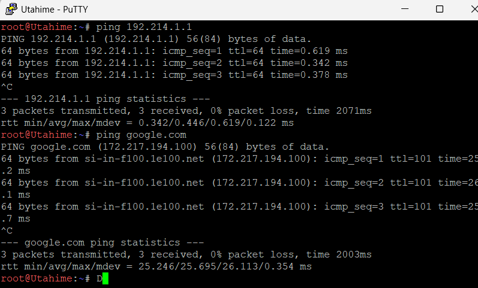

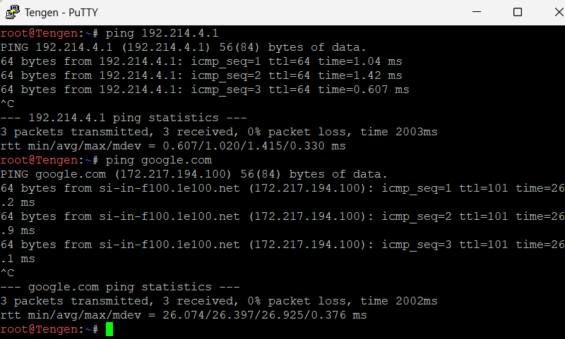


Dari hasil pengujian di atas, seluruh host infrastruktur berhasil menjangkau gateway dan internet publik, membuktikan bahwa konfigurasi IP statis, IPv4 forwarding, serta Source NAT pada `jichi` telah berjalan sesuai rancangan.


### 2 - Konfigurasi DHCP Server pada Tengen

Soal 2 meminta `tengen` difungsikan sebagai DHCP Server terpusat bagi seluruh jaringan yang membutuhkan alokasi alamat dinamis. Karena `tengen` berada di Network 4, subnet tersebut harus dideklarasikan di konfigurasi tanpa pool dinamis agar service tidak mengeluarkan error `No subnet declaration` saat pertama kali dijalankan. Selain itu, dua scope DHCP disiapkan untuk Network 2 dan Network 3 sebagai fondasi yang akan dilengkapi dengan pool, lease time, dan aturan alokasi pada soal-soal berikutnya.

#### Instalasi isc-dhcp-server

Paket `isc-dhcp-server` diinstal terlebih dahulu pada `tengen`:

```bash
apt-get update
apt-get install -y isc-dhcp-server
```

#### Konfigurasi Interface Listener

`isc-dhcp-server` perlu diarahkan untuk mendengarkan pada `eth0`, yaitu antarmuka `tengen` yang terhubung ke Network 4:

```bash
cat > /etc/default/isc-dhcp-server << EOF
INTERFACESv4="eth0"
INTERFACESv6=""
EOF
```

#### Konfigurasi dhcpd.conf

File `/etc/dhcp/dhcpd.conf` dikonfigurasi dengan tiga deklarasi subnet. Network 4 dideklarasikan tanpa pool agar service aktif. Network 2 dan Network 3 disiapkan dengan opsi dasar sebagai fondasi konfigurasi pool di soal berikutnya:

```bash
cat > /etc/dhcp/dhcpd.conf << EOF
# Global
option domain-name-servers 192.214.1.2, 192.214.1.3;
default-lease-time 600;
max-lease-time 7200;
authoritative;

# Network 4 - subnet lokal tengen, tanpa pool dinamis
subnet 192.214.4.0 netmask 255.255.255.0 {
}

# Network 2 - Divisi A (pool dan class dikonfigurasi di soal 4)
subnet 192.214.2.0 netmask 255.255.255.0 {
    option routers 192.214.2.1;
    option broadcast-address 192.214.2.255;
    option domain-name-servers 192.214.1.2, 192.214.1.3;
}

# Network 3 - Divisi B (pool dan lease time dikonfigurasi di soal 5)
subnet 192.214.3.0 netmask 255.255.255.0 {
    option routers 192.214.3.1;
    option broadcast-address 192.214.3.255;
    option domain-name-servers 192.214.1.2, 192.214.1.3;
}
EOF
```

#### Validasi dan Start Service

Konfigurasi divalidasi lalu service dijalankan:

```bash
dhcpd -t -cf /etc/dhcp/dhcpd.conf
service isc-dhcp-server restart
service isc-dhcp-server status
```


Dari hasil di atas, service `isc-dhcp-server` berjalan tanpa error `No subnet declaration` karena Network 4 sudah dideklarasikan sebagai subnet lokal meskipun tanpa pool dinamis.

#### Script Lengkap 

Script berikut disimpan di `tengen` sebagai `soal2.sh`.

```bash
#!/bin/bash
# Soal 2 - DHCP Server. 

apt-get update
apt-get install -y isc-dhcp-server

cat > /etc/default/isc-dhcp-server << EOF
INTERFACESv4="eth0"
INTERFACESv6=""
EOF

cat > /etc/dhcp/dhcpd.conf << EOF
# Global
option domain-name-servers 192.214.1.2, 192.214.1.3;
default-lease-time 600;
max-lease-time 7200;
authoritative;

# Network 4 - subnet lokal tengen, tanpa pool dinamis
subnet 192.214.4.0 netmask 255.255.255.0 {
}

# Network 2 - Divisi A (pool dan class dikonfigurasi di soal 4)
subnet 192.214.2.0 netmask 255.255.255.0 {
    option routers 192.214.2.1;
    option broadcast-address 192.214.2.255;
    option domain-name-servers 192.214.1.2, 192.214.1.3;
}

# Network 3 - Divisi B (pool dan lease time dikonfigurasi di soal 5)
subnet 192.214.3.0 netmask 255.255.255.0 {
    option routers 192.214.3.1;
    option broadcast-address 192.214.3.255;
    option domain-name-servers 192.214.1.2, 192.214.1.3;
}
EOF

dhcpd -t -cf /etc/dhcp/dhcpd.conf
service isc-dhcp-server restart
service isc-dhcp-server status
```

### 3 - Konfigurasi DHCP Relay pada Jichi

Karena `tengen` berada di Network 4 sementara klien berada di Network 2 dan Network 3, paket DHCP Discover dari klien tidak dapat mencapai `tengen` secara langsung karena router tidak meneruskan broadcast antar subnet. Soal 3 meminta `jichi` difungsikan sebagai DHCP Relay yang bertugas menangkap broadcast DHCP dari kedua subnet klien dan meneruskannya sebagai unicast ke `tengen` di `192.214.4.10`. `jichi` mendengarkan pada `eth2` untuk Network 2 dan `eth3` untuk Network 3, sehingga proses DORA dapat terjadi melewati batas subnet.

#### Instalasi isc-dhcp-relay

Paket `isc-dhcp-relay` diinstal pada `jichi`:

```bash
apt-get update
apt-get install -y isc-dhcp-relay
```

Saat instalasi, wizard interaktif akan muncul. Tekan Enter saja untuk melewatinya karena konfigurasi akan ditulis manual.

#### Konfigurasi DHCP Relay

File `/etc/default/isc-dhcp-relay` dikonfigurasi agar relay meneruskan ke `tengen` dan mendengarkan pada `eth2` serta `eth3`:

```bash
cat > /etc/default/isc-dhcp-relay << EOF
SERVERS="192.214.4.10"
INTERFACES="eth2 eth3"
OPTIONS=""
EOF
```

#### Start Service

```bash
dhcrelay -d -iu eth4 -id eth2 -id eth3 192.214.4.10
```


#### Bukti Lease pada Klien

Pengujian dilakukan dari klien di kedua subnet dengan meminta IP melalui DHCP:

```bash
ip addr flush dev eth0
udhcpc -i eth0
ip -4 -br addr
```

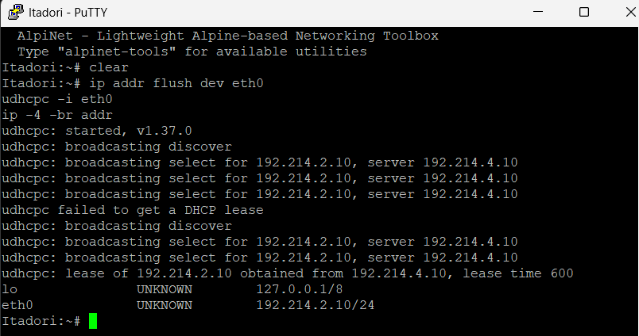


Klien dari Network 2 dan Network 3 berhasil memperoleh lease dari `tengen` melalui relay di `jichi`, dibuktikan dengan alamat IP yang terdapat pada rentang subnet masing-masing.

#### Script Lengkap

Script berikut disimpan di node `jichi` sebagai `soal3.sh`:

```bash
#!/bin/bash

apt-get update
apt-get install -y isc-dhcp-relay

cat > /etc/default/isc-dhcp-relay << EOF
SERVERS="192.214.4.10"
INTERFACES="eth2 eth3"
OPTIONS=""
EOF

dhcrelay -d -iu eth4 -id eth2 -id eth3 192.214.4.10
```

### 4 - DHCP Pool Berbasis MAC untuk Network 2

Soal 4 meminta alokasi alamat di Network 2 dikendalikan berdasarkan identitas hardware klien. Itadori dan Fushiguro harus selalu memperoleh alamat dari Pool 1 (`192.214.2.10–192.214.2.35`), sedangkan Zenin dan Okkotsu dari Pool 2 (`192.214.2.70–192.214.2.95`). Rentang 192.214.2.36–192.214.2.69 tidak termasuk dalam pool DHCP yang dikonfigurasi pada Soal 4, sehingga server tidak mengalokasikan alamat dari rentang tersebut melalui kedua pool ini. Mekanisme ini diimplementasikan menggunakan `class` dan `subclass` pada `isc-dhcp-server` yang mencocokkan paket DHCP berdasarkan MAC address hardware klien, sehingga meskipun relay meneruskan request dari subnet yang sama, server tetap dapat membedakan klien dan memberikan pool yang tepat.

#### Deklarasi Class Berdasarkan MAC

> **Node: `tengen` (`192.214.4.10`)**
> File: `/etc/dhcp/dhcpd.conf`

Dua class dibuat: `pool1` untuk itadori dan fushiguro, serta `pool2` untuk zenin dan okkotsu. Prefix `1:` pada subclass menandakan hardware type Ethernet:

```
class "pool1" {
    match hardware;
}
subclass "pool1" 1:02:42:5f:04:2c:00;  # itadori
subclass "pool1" 1:02:42:9a:a3:61:00;  # fushiguro

class "pool2" {
    match hardware;
}
subclass "pool2" 1:02:42:e3:66:69:00;  # zenin
subclass "pool2" 1:02:42:00:59:dd:00;  # okkotsu
```

#### Konfigurasi Pool pada Subnet Network 2

> **Node: `tengen` (`192.214.4.10`)**
> File: `/etc/dhcp/dhcpd.conf`

Subnet Network 2 diperbarui dengan dua pool yang masing-masing hanya mengizinkan member dari class yang sesuai. Rentang `.36–.69` tidak dimasukkan ke pool manapun sehingga tidak pernah dialokasikan:

```
subnet 192.214.2.0 netmask 255.255.255.0 {
    option routers 192.214.2.1;
    option broadcast-address 192.214.2.255;
    option domain-name-servers 192.214.1.2, 192.214.1.3;

    pool {
        allow members of "pool1";
        range 192.214.2.10 192.214.2.35;
    }

    pool {
        allow members of "pool2";
        range 192.214.2.70 192.214.2.95;
    }
}
```

#### Validasi dan Restart Service

> **Node: `tengen` (`192.214.4.10`)**

```bash
dhcpd -t -cf /etc/dhcp/dhcpd.conf
service isc-dhcp-server restart
service isc-dhcp-server status
```

#### Bukti Lease pada Klien

> **Node: `itadori`, `fushiguro`, `zenin`, `okkotsu`** (masing-masing dijalankan di terminalnya sendiri)

```bash
ip addr flush dev eth0
udhcpc -i eth0
ip -4 -br addr
```

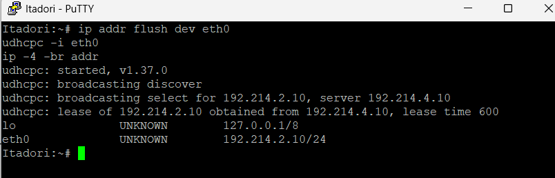


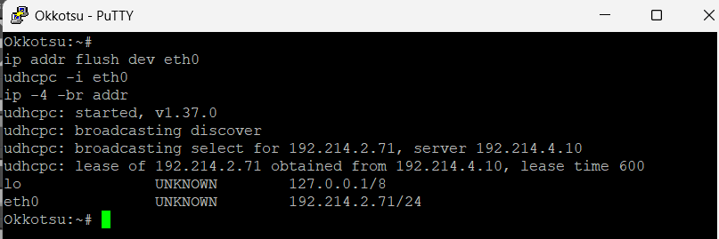

Itadori dan Fushiguro memperoleh alamat dari Pool 1, sedangkan Zenin dan Okkotsu dari Pool 2, membuktikan bahwa seleksi pool berbasis MAC berjalan sesuai rancangan.

#### Script Lengkap 

Script berikut disimpan di node `Tengen` sebagai `soal4.sh`:

```bash
#!/bin/bash
# Soal 4 

cat > /etc/dhcp/dhcpd.conf << EOF
# Global
option domain-name-servers 192.214.1.2, 192.214.1.3;
default-lease-time 600;
max-lease-time 7200;
authoritative;

# Class berdasarkan MAC - Network 2
class "pool1" {
    match hardware;
}
subclass "pool1" 1:02:42:5f:04:2c:00;  # itadori
subclass "pool1" 1:02:42:9a:a3:61:00;  # fushiguro

class "pool2" {
    match hardware;
}
subclass "pool2" 1:02:42:e3:66:69:00;  # zenin
subclass "pool2" 1:02:42:00:59:dd:00;  # okkotsu

# Network 4 - subnet lokal tengen, tanpa pool dinamis
subnet 192.214.4.0 netmask 255.255.255.0 {
}

# Network 2 - Divisi A
subnet 192.214.2.0 netmask 255.255.255.0 {
    option routers 192.214.2.1;
    option broadcast-address 192.214.2.255;
    option domain-name-servers 192.214.1.2, 192.214.1.3;

    pool {
        allow members of "pool1";
        range 192.214.2.10 192.214.2.35;
    }

    pool {
        allow members of "pool2";
        range 192.214.2.70 192.214.2.95;
    }
}

# Network 3 - Divisi B (pool dan lease time dikonfigurasi di soal 5)
subnet 192.214.3.0 netmask 255.255.255.0 {
    option routers 192.214.3.1;
    option broadcast-address 192.214.3.255;
    option domain-name-servers 192.214.1.2, 192.214.1.3;
}
EOF

dhcpd -t -cf /etc/dhcp/dhcpd.conf
service isc-dhcp-server restart
service isc-dhcp-server status
```
### 5 - DHCP Pool dengan Lease Time Berbeda untuk Network 3

Soal 5 meminta Network 3 memiliki dua pool dengan lease time yang berbeda sesuai kebutuhan tiap klien. Ino dan Kusakabe masuk ke pool short lease (`192.214.3.10–192.214.3.89`) dengan waktu sewa 1800 detik, sedangkan Miwa masuk ke pool long lease (`192.214.3.100–192.214.3.199`) dengan waktu sewa 43200 detik. Pemisahan ini dilakukan menggunakan class berbasis MAC seperti soal 4, sehingga tiap klien selalu diarahkan ke pool yang sesuai. Kugisaki tidak dimasukkan ke class manapun karena akan mendapat fixed address di soal 6. Selain itu, seluruh klien Network 3 menerima opsi `domain-search` menuju `<K-06>.com`.

#### Deklarasi Class Berdasarkan MAC

> **Node: `tengen` (`192.214.4.10`)**
> File: `/etc/dhcp/dhcpd.conf`

```
class "short-lease" {
    match hardware;
}
subclass "short-lease" 1:02:42:2c:e9:ee:00;  # ino
subclass "short-lease" 1:02:42:f5:9c:59:00;  # kusakabe

class "long-lease" {
    match hardware;
}
subclass "long-lease" 1:02:42:0b:75:87:00;   # miwa
```

#### Konfigurasi Pool pada Subnet Network 3

> **Node: `tengen` (`192.214.4.10`)**
> File: `/etc/dhcp/dhcpd.conf`

Dua pool dikonfigurasi di dalam subnet Network 3. Lease time ditulis per pool agar tidak saling menimpa nilai global:

```
# Network 3 - Divisi B
subnet 192.214.3.0 netmask 255.255.255.0 {
    option routers 192.214.3.1;
    option broadcast-address 192.214.3.255;
    option domain-name-servers 192.214.1.2, 192.214.1.3;
    option domain-search "K-06.com";

    pool {
        allow members of "short-lease";
        range 192.214.3.10 192.214.3.89;
        default-lease-time 1800;
        max-lease-time 1800;
    }

    pool {
        allow members of "long-lease";
        range 192.214.3.100 192.214.3.199;
        default-lease-time 43200;
        max-lease-time 43200;
    }
}
```

#### Validasi dan Restart Service

> **Node: `tengen` (`192.214.4.10`)**

```bash
dhcpd -t -cf /etc/dhcp/dhcpd.conf
service isc-dhcp-server restart
service isc-dhcp-server status
```


#### Bukti Lease pada Klien

> **Node: `ino`, `kusakabe`, `miwa`** (masing-masing dijalankan di terminalnya sendiri)

```bash
ip addr flush dev eth0
udhcpc -i eth0
ip -4 -br addr
```

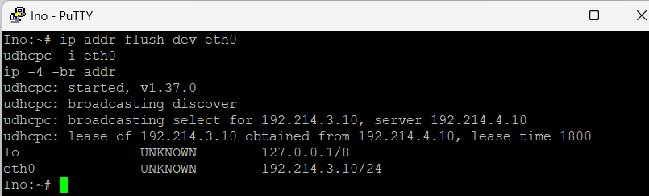

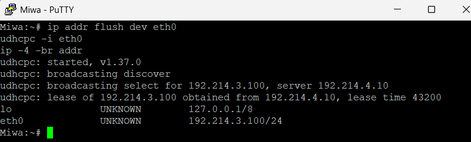

Ino alamat dari pool short lease, sedangkan Miwa dari pool long lease. Lease time dapat diverifikasi dengan melihat isi `/var/lib/dhcp/dhcpd.leases` di `tengen`.


#### Script Lengkap

>Script berikut disimpan di node `Tengen` sebagai `soal4.sh`:


```bash
#!/bin/bash
# Soal 5 - DHCP Pool lease time berbeda.

cat > /etc/dhcp/dhcpd.conf << EOF
# Global
option domain-name-servers 192.214.1.2, 192.214.1.3;
default-lease-time 600;
max-lease-time 7200;
authoritative;

# Class berdasarkan MAC - Network 2
class "pool1" {
    match hardware;
}
subclass "pool1" 1:02:42:5f:04:2c:00;  # itadori
subclass "pool1" 1:02:42:9a:a3:61:00;  # fushiguro

class "pool2" {
    match hardware;
}
subclass "pool2" 1:02:42:e3:66:69:00;  # zenin
subclass "pool2" 1:02:42:00:59:dd:00;  # okkotsu

# Class berdasarkan MAC - Network 3
class "short-lease" {
    match hardware;
}
subclass "short-lease" 1:02:42:2c:e9:ee:00;  # ino
subclass "short-lease" 1:02:42:f5:9c:59:00;  # kusakabe

class "long-lease" {
    match hardware;
}
subclass "long-lease" 1:02:42:0b:75:87:00;   # miwa

# Network 4 - subnet lokal tengen, tanpa pool dinamis
subnet 192.214.4.0 netmask 255.255.255.0 {
}

# Network 2 - Divisi A
subnet 192.214.2.0 netmask 255.255.255.0 {
    option routers 192.214.2.1;
    option broadcast-address 192.214.2.255;
    option domain-name-servers 192.214.1.2, 192.214.1.3;

    pool {
        allow members of "pool1";
        range 192.214.2.10 192.214.2.35;
    }

    pool {
        allow members of "pool2";
        range 192.214.2.70 192.214.2.95;
    }
}

# Network 3 - Divisi B
subnet 192.214.3.0 netmask 255.255.255.0 {
    option routers 192.214.3.1;
    option broadcast-address 192.214.3.255;
    option domain-name-servers 192.214.1.2, 192.214.1.3;
    option domain-search "<K-06>.com";

    pool {
        allow members of "short-lease";
        range 192.214.3.10 192.214.3.89;
        default-lease-time 1800;
        max-lease-time 1800;
    }

    pool {
        allow members of "long-lease";
        range 192.214.3.100 192.214.3.199;
        default-lease-time 43200;
        max-lease-time 43200;
    }
}
EOF

dhcpd -t -cf /etc/dhcp/dhcpd.conf
service isc-dhcp-server restart
service isc-dhcp-server status
```

### 6 - DHCP Fixed Address untuk Kugisaki

Soal 6 meminta Kugisaki selalu mendapatkan alamat yang sama setiap kali terhubung ke jaringan, yaitu `192.214.3.99`. Mekanisme ini diimplementasikan menggunakan deklarasi `host` pada `isc-dhcp-server` yang mengikat MAC address Kugisaki ke satu alamat tetap. Alamat `192.214.3.99` dipilih karena berada di luar seluruh pool dinamis Network 3, yaitu di antara rentang short lease (`.3.10–.3.89`) dan long lease (`.3.100–.3.199`), sehingga tidak pernah dialokasikan secara dinamis ke klien lain.

#### Deklarasi Host Fixed Address

> **Node: `tengen` (`192.214.4.10`)**
> File: `/etc/dhcp/dhcpd.conf`

Deklarasi `host` ditambahkan di dalam blok subnet Network 3, mengikat MAC Kugisaki ke alamat `192.214.3.99`:

```
host kugisaki {
    hardware ethernet 02:42:df:72:fc:00;
    fixed-address 192.214.3.99;
}
```

#### Validasi dan Restart Service

> **Node: `tengen` (`192.214.4.10`)**

```bash
dhcpd -t -cf /etc/dhcp/dhcpd.conf
service isc-dhcp-server restart
service isc-dhcp-server status
```


#### Bukti Lease pada Kugisaki

> **Node: `kugisaki`**

Lease diperbarui dengan melepas alamat lama lalu meminta ulang:

```bash
ip addr flush dev eth0
udhcpc -i eth0
ip -4 -br addr
```

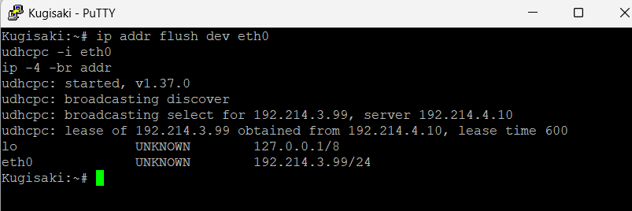

Alamat yang diterima Kugisaki adalah `192.214.3.99` sesuai reservasi, membuktikan bahwa fixed address berhasil diikat berdasarkan MAC address.

#### Script Lengkap (dhcp-fixed.sh)

Script berikut disimpan di node `Tengen` sebagai `soal6.sh`:

```bash
#!/bin/bash
cat > /etc/dhcp/dhcpd.conf << EOF
# Global
option domain-name-servers 192.214.1.2, 192.214.1.3;
default-lease-time 600;
max-lease-time 7200;
authoritative;

# Class berdasarkan MAC - Network 2
class "pool1" {
    match hardware;
}
subclass "pool1" 1:02:42:5f:04:2c:00;  # itadori
subclass "pool1" 1:02:42:9a:a3:61:00;  # fushiguro

class "pool2" {
    match hardware;
}
subclass "pool2" 1:02:42:e3:66:69:00;  # zenin
subclass "pool2" 1:02:42:00:59:dd:00;  # okkotsu

# Class berdasarkan MAC - Network 3
class "short-lease" {
    match hardware;
}
subclass "short-lease" 1:02:42:2c:e9:ee:00;  # ino
subclass "short-lease" 1:02:42:f5:9c:59:00;  # kusakabe

class "long-lease" {
    match hardware;
}
subclass "long-lease" 1:02:42:0b:75:87:00;   # miwa

# Network 4 - subnet lokal tengen, tanpa pool dinamis
subnet 192.214.4.0 netmask 255.255.255.0 {
}

# Network 2 - Divisi A
subnet 192.214.2.0 netmask 255.255.255.0 {
    option routers 192.214.2.1;
    option broadcast-address 192.214.2.255;
    option domain-name-servers 192.214.1.2, 192.214.1.3;

    pool {
        allow members of "pool1";
        range 192.214.2.10 192.214.2.35;
    }

    pool {
        allow members of "pool2";
        range 192.214.2.70 192.214.2.95;
    }
}

# Network 3 - Divisi B
subnet 192.214.3.0 netmask 255.255.255.0 {
    option routers 192.214.3.1;
    option broadcast-address 192.214.3.255;
    option domain-name-servers 192.214.1.2, 192.214.1.3;
    option domain-search "<K-06>.com";

    pool {
        allow members of "short-lease";
        range 192.214.3.10 192.214.3.89;
        default-lease-time 1800;
        max-lease-time 1800;
    }

    pool {
        allow members of "long-lease";
        range 192.214.3.100 192.214.3.199;
        default-lease-time 43200;
        max-lease-time 43200;
    }

    host kugisaki {
        hardware ethernet 02:42:df:72:fc:00;
        fixed-address 192.214.3.99;
    }
}
EOF

dhcpd -t -cf /etc/dhcp/dhcpd.conf
service isc-dhcp-server restart
service isc-dhcp-server status
```

### 7 - Verifikasi Konfigurasi Klien dan dhcpd.leases

Soal 7 meminta pembuktian bahwa seluruh klien telah memperoleh alamat sesuai konfigurasi DHCP yang dirancang, dengan cara mencocokkan IP yang diterima klien terhadap entri di file `dhcpd.leases` pada `tengen`. File tersebut mencatat setiap lease yang diberikan server beserta MAC address, waktu mulai, dan waktu berakhirnya, sehingga dapat dijadikan referensi otoritatif untuk memvalidasi bahwa pool, lease time, dan fixed address bekerja sesuai rancangan.

#### Verifikasi IP pada Klien

> **Node: seluruh klien** (masing-masing di terminalnya sendiri)

```bash
ip -4 -br addr
```

**Network 2: Divisi A**

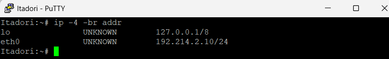


**Network 3: Divisi B**


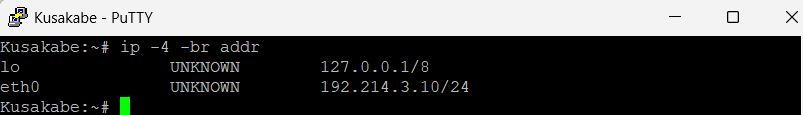


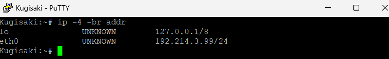

#### Verifikasi dhcpd.leases pada Tengen

> **Node: `tengen` (`192.214.4.10`)**

```bash
cat /var/lib/dhcp/dhcpd.leases
```


Setiap entri lease di file tersebut memuat informasi berikut yang dicocokkan dengan data klien:

| Field | Keterangan |
|---|---|
| `lease <IP>` | Alamat yang diberikan ke klien |
| `hardware ethernet` | MAC address klien penerima lease |
| `starts` / `ends` | Waktu mulai dan berakhirnya lease |
| `binding state active` | Lease sedang aktif digunakan |

Tabel berikut merangkum kesesuaian antara konfigurasi yang dirancang dengan hasil aktual:

| Klien | MAC Address | IP yang Diharapkan | Pool / Keterangan |
|---|---|---|---|
| itadori | `02:42:5f:04:2c:00` | `192.214.2.10–.35` | Pool 1 |
| fushiguro | `02:42:9a:a3:61:00` | `192.214.2.10–.35` | Pool 1 |
| zenin | `02:42:e3:66:69:00` | `192.214.2.70–.95` | Pool 2 |
| okkotsu | `02:42:00:59:dd:00` | `192.214.2.70–.95` | Pool 2 |
| ino | `02:42:2c:e9:ee:00` | `192.214.3.10–.89` | Short lease (1800s) |
| kusakabe | `02:42:f5:9c:59:00` | `192.214.3.10–.89` | Short lease (1800s) |
| miwa | `02:42:0b:75:87:00` | `192.214.3.100–.199` | Long lease (43200s) |
| kugisaki | `02:42:df:72:fc:00` | `192.214.3.99` | Fixed address |

Seluruh entri di `dhcpd.leases` menunjukkan MAC address yang sesuai dengan klien yang bersangkutan dan alamat IP yang berada di rentang pool yang benar, membuktikan bahwa konfigurasi DHCP berjalan sesuai rancangan.

### 8 - Packet Capture DORA dan Field giaddr

Soal 8 meminta pembuktian alur DORA (Discover, Offer, Request, Acknowledge) melalui packet capture, sekaligus memverifikasi bahwa field `giaddr` pada paket DHCP terisi dengan benar. Field `giaddr` (Gateway IP Address) diisi oleh relay agent (`jichi`) saat meneruskan paket dari klien ke `tengen`, berisi IP interface `jichi` di sisi subnet klien. Dengan adanya `giaddr`, `tengen` mengetahui dari subnet mana request berasal dan ke mana Offer harus dikembalikan. Capture dilakukan di `jichi` pada interface `eth4` (arah ke `tengen`) dengan output disimpan ke file, sehingga tcpdump dapat berjalan di background dan hasilnya dibaca setelah proses DORA selesai.

#### Langkah 1: Jalankan tcpdump di Background

> **Node: `jichi`**

Jalankan tcpdump di background. Flag `-c 8` menghentikan capture otomatis setelah 8 paket tertangkap (cukup untuk satu siklus DORA bolak-balik):

```bash
tcpdump -i eth4 -v -n -c 8 port 67 > /root/dora.txt 2>&1 &
echo "tcpdump berjalan, PID: $!"
```

#### Langkah 2: Picu DORA dari Klien

> **Node: `itadori`** (terminal klien)

Lepas IP lama lalu minta lease baru:

```bash
ip addr flush dev eth0
udhcpc -i eth0
```

#### Langkah 3: Baca Hasil Capture di Jichi

> **Node: `jichi`**

Tunggu beberapa detik hingga tcpdump selesai (berhenti otomatis setelah 8 paket), lalu baca hasilnya:

```bash
cat /root/dora.txt
```

Contoh output yang diharapkan:

```
# 1. DHCP Discover (relay -> tengen, giaddr sudah terisi)
IP 192.214.2.1.67 > 192.214.4.10.67: BOOTP/DHCP, Request from 02:42:5f:04:2c:00
  giaddr 192.214.2.1
  DHCP-Message Option 53, length 1: Discover

# 2. DHCP Offer (tengen -> relay via giaddr)
IP 192.214.4.10.67 > 192.214.2.1.67: BOOTP/DHCP, Reply
  giaddr 192.214.2.1
  DHCP-Message Option 53, length 1: Offer

# 3. DHCP Request (relay -> tengen, giaddr sudah terisi)
IP 192.214.2.1.67 > 192.214.4.10.67: BOOTP/DHCP, Request from 02:42:5f:04:2c:00
  giaddr 192.214.2.1
  DHCP-Message Option 53, length 1: Request

# 4. DHCP Ack (tengen -> relay via giaddr)
IP 192.214.4.10.67 > 192.214.2.1.67: BOOTP/DHCP, Reply
  giaddr 192.214.2.1
  DHCP-Message Option 53, length 1: ACK
```


#### Penjelasan Field giaddr

Nilai `giaddr` pada seluruh paket DORA adalah `192.214.2.1`, yaitu IP `jichi` di sisi Network 2 (`eth2`). Hal ini membuktikan bahwa relay agent mengisi `giaddr` sebelum meneruskan paket ke `tengen`, dan `tengen` menggunakan nilai tersebut untuk menentukan subnet asal request, memilih pool yang sesuai, serta mengirim balasan kembali ke relay. Untuk Network 3, nilai `giaddr` yang diharapkan adalah `192.214.3.1`. Pengujian dapat diulang dari `ino` dengan prosedur yang sama.

```bash
# Ulangi dari jichi untuk Network 3
tcpdump -i eth4 -v -n -c 8 port 67 > /root/dora_net3.txt 2>&1 &
```

```bash
# Lalu dari ino
ip addr flush dev eth0
udhcpc -i eth0
```

```bash
# Kembali ke jichi
cat /root/dora_net3.txt
```
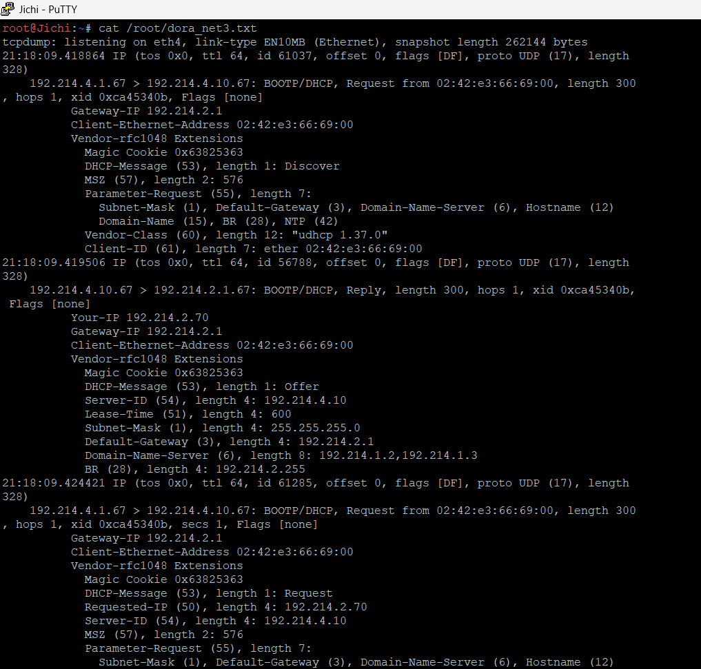

### 9 - Simulasi Relay Mati dan Pemulihan

Soal 9 meminta pembuktian bahwa sistem DHCP bergantung penuh pada relay di `jichi`. Ketika relay dimatikan, klien di Network 2 dan Network 3 tidak dapat memperoleh lease karena paket Discover tidak pernah sampai ke `tengen`. Setelah relay dipulihkan, klien kembali dapat memperoleh alamat secara normal. Pengujian ini membuktikan peran kritis `jichi` sebagai jembatan antara subnet klien dan DHCP server.

#### Langkah 1: Catat Kondisi Awal Klien

> **Node: `itadori`**

Pastikan klien sudah memiliki lease sebelum pengujian dimulai:

```bash
ip -4 -br addr
```

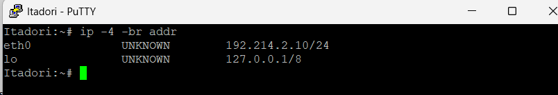

#### Langkah 2: Matikan Relay di Jichi

> **Node: `jichi`**

```bash
kill $(pgrep dhcrelay)
ps aux | grep dhcrelay
```

#### Langkah 3: Coba Minta Lease dari Klien (Harus Gagal)

> **Node: `itadori`**

Lepas IP lama lalu coba minta lease baru. Karena relay mati, udhcpc akan timeout tanpa mendapat balasan:

```bash
ip addr flush dev eth0
udhcpc -i eth0
```

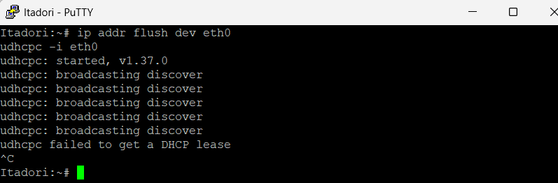

#### Langkah 4: Pulihkan Relay di Jichi

> **Node: `jichi`**

```bash
dhcrelay -d -iu eth4 -id eth2 -id eth3 192.214.4.10
```

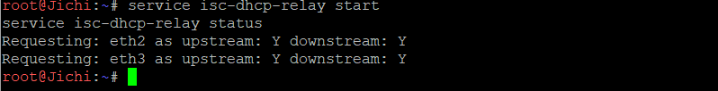

#### Langkah 5: Minta Lease Ulang dari Klien (Harus Berhasil)

> **Node: `itadori`**

```bash
udhcpc -i eth0
ip -4 -br addr
```


Setelah relay dipulihkan, klien berhasil memperoleh lease dari `tengen` seperti semula, membuktikan bahwa `jichi` sebagai relay merupakan komponen kritis yang harus selalu aktif agar alokasi DHCP lintas subnet dapat berjalan.

### 10 - Autostart dan Uji Restart

Soal 10 memastikan bahwa seluruh service DHCP bangkit kembali secara otomatis ketika node di-restart tanpa intervensi manual. Karena `debinet` tidak menggunakan systemd, autostart dikonfigurasi melalui `post-up` di `/etc/network/interfaces` pada masing-masing node via GNS3 Edit config. Pada `tengen`, `post-up` menjalankan `/root/soal6.sh` agar `dhcpd.conf` selalu ditulis ulang dan service di-restart dengan konfigurasi final yang mencakup seluruh konfigurasi soal 2 hingga 6. Instalasi `isc-dhcp-server` cukup dilakukan sekali secara manual karena paket tidak hilang saat node di-restart. Pada `jichi`, `post-up` menjalankan `/root/soal3.sh` agar `isc-dhcp-relay` terinstall dan `dhcrelay` berjalan otomatis. Flag `-d` dihilangkan dari `soal3.sh` agar `dhcrelay` melakukan self-daemonize dan tidak memblokir proses boot.


#### Update soal3.sh di Jichi

> **Node: `jichi`**
> File: `/root/soal3.sh`

Hapus flag `-d` agar `dhcrelay` self-daemonize dan tidak memblokir `post-up`:

```bash
#!/bin/bash

apt-get update
DEBIAN_FRONTEND=noninteractive apt-get install -y isc-dhcp-relay

cat > /etc/default/isc-dhcp-relay << EOF
SERVERS="192.214.4.10"
INTERFACES="eth2 eth3"
OPTIONS=""
EOF

# Tunggu tengen siap
until ping -c 1 192.214.4.10 > /dev/null 2>&1; do
    echo "Menunggu tengen..."; sleep 3
done

dhcrelay -iu eth4 -id eth2 -id eth3 192.214.4.10
```

dhcrelay baru akan aktif setelah node Tengen sudah tersetup.

#### Konfigurasi Autostart pada Tengen

> **Node: `tengen` (`192.214.4.10`)**
> File: `/etc/network/interfaces` (Edit config di GNS3)

```
auto lo
iface lo inet loopback

auto eth0
iface eth0 inet static
    address 192.214.4.10
    netmask 255.255.255.0
    gateway 192.214.4.1
    post-up echo "nameserver 192.168.122.1" > /etc/resolv.conf
post-up /bin/sh -c '/bin/bash /root/soal2.sh; sleep 5; /bin/bash /root/soal6.sh'
```

Tengen akan menjalankan soal2.sh terlebih dahulu dan menunggu 5 detik sebelum menjalankan soal6.sh.

#### Konfigurasi Autostart pada Jichi

> **Node: `jichi`**
> File: `/etc/network/interfaces` (Edit config di GNS3)

```
auto lo
iface lo inet loopback

auto eth0
iface eth0 inet dhcp
    post-up echo "nameserver 192.168.122.1" > /etc/resolv.conf
    post-up sysctl -w net.ipv4.ip_forward=1
    post-up iptables -t nat -C POSTROUTING -o eth0 -s 192.214.0.0/16 -j MASQUERADE || iptables -t nat -A POSTROUTING -o eth0 -s 192.214.0.0/16 -j MASQUERADE

auto eth1
iface eth1 inet static
    address 192.214.1.1
    netmask 255.255.255.0

auto eth2
iface eth2 inet static
    address 192.214.2.1
    netmask 255.255.255.0

auto eth3
iface eth3 inet static
    address 192.214.3.1
    netmask 255.255.255.0

auto eth4
iface eth4 inet static
    address 192.214.4.1
    netmask 255.255.255.0
    post-up bash /root/soal3.sh
```

#### Urutan Start yang Benar

Karena `tengen` membutuhkan internet dari `jichi` untuk instalasi paket, urutan start node harus diperhatikan:

| Urutan | Node | Alasan |
|---|---|---|
| 1 | `jichi` | Gateway semua jaringan, NAT, dan relay harus aktif lebih dulu |
| 2 | `tengen` | Butuh `jichi` untuk internet saat `soal6.sh` berjalan |
| 3 | Server lain | Butuh `jichi` sebagai gateway |
| 4 | Klien | Butuh `tengen` untuk DHCP dan `jichi` sebagai relay |

#### Uji Restart Tengen

> **Node: `tengen`**

Stop lalu Start node `tengen` dari GNS3. Setelah node kembali aktif, verifikasi service berjalan otomatis:

```bash
service isc-dhcp-server status
```

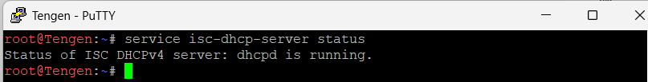

#### Uji Restart Jichi

> **Node: `jichi`**

Stop lalu Start node `jichi` dari GNS3. Setelah node kembali aktif, verifikasi `dhcrelay` berjalan otomatis:

```bash
ps aux | grep dhcrelay
```

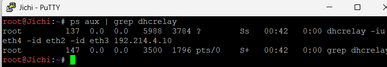

#### Uji Akhir: Klien Masih Bisa Mendapat Lease

> **Node: `itadori`**

Setelah kedua node di-restart, pastikan klien masih bisa memperoleh lease:

```bash
ip addr flush dev eth0
udhcpc -i eth0
ip -4 -br addr
```

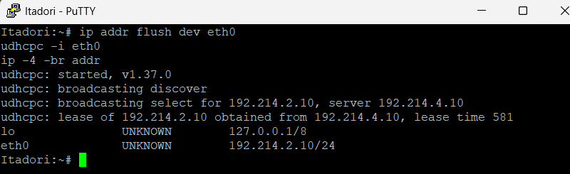

Seluruh service bangkit kembali secara otomatis setelah restart tanpa intervensi manual, membuktikan konfigurasi autostart pada `tengen` dan `jichi` berjalan sesuai rancangan.


### 11 - Konfigurasi DNS Master dan Slave

Soal 11 meminta sistem penamaan domain dibangun agar node dapat berkomunikasi menggunakan nama alih-alih alamat IP mentah. `utahime` dikonfigurasi sebagai DNS Master yang memegang otoritas atas zona `jujutsu.K-06.com`, sedangkan `shoko` sebagai DNS Slave yang menerima salinan zona secara otomatis dari Master melalui mekanisme *zone transfer*. SOA record mendefinisikan metadata zona, termasuk serial number sebagai penanda versi, sementara NS record menetapkan server DNS yang berwenang atas zona. Sinkronisasi dibuktikan dengan menaikkan serial pada Utahime dan memverifikasi bahwa Shoko menerima zona terbaru tanpa konfigurasi ulang.

#### Instalasi BIND9

**Node: `utahime` dan `shoko`** (jalankan pada masing-masing node).

```bash
apt-get update
apt-get install -y bind9 bind9utils bind9-doc
```

#### Konfigurasi `named.conf.local` pada Utahime

**Node: `utahime` (`192.214.1.2`)**

File: `/etc/bind/named.conf.local`

```bash
cat > /etc/bind/named.conf.local << 'EOF'
zone "jujutsu.K-06.com" {
    type master;
    file "/etc/bind/zones/jujutsu.K-06.com";
    allow-transfer { 192.214.1.3; };
};
EOF
```

Konfigurasi tersebut menetapkan Utahime sebagai DNS Master dan mengizinkan Shoko mengambil salinan zona melalui mekanisme *zone transfer*.

#### Konfigurasi `named.conf.local` pada Shoko

**Node: `shoko` (`192.214.1.3`)**

File: `/etc/bind/named.conf.local`

```bash
cat > /etc/bind/named.conf.local << 'EOF'
zone "jujutsu.K-06.com" {
    type slave;
    file "/var/cache/bind/jujutsu.K-06.com";
    masters { 192.214.1.2; };
};
EOF
```

Konfigurasi tersebut menetapkan Shoko sebagai DNS Slave dengan Utahime sebagai sumber zona.

#### Konfigurasi `named.conf.options`

**Node: `utahime` dan `shoko`** (jalankan pada masing-masing node).

File: `/etc/bind/named.conf.options`

```bash
cat > /etc/bind/named.conf.options << 'EOF'
options {
    directory "/var/cache/bind";
    allow-query { any; };
    recursion yes;
    forwarders {
        192.168.122.1;
    };
    dnssec-validation no;
    listen-on-v6 { any; };
};
EOF
```

Konfigurasi ini mengatur direktori kerja BIND9, mengizinkan permintaan DNS, mengaktifkan pencarian rekursif, dan menetapkan DNS forwarder `192.168.122.1`.

#### Pembuatan File Zona pada Utahime

**Node: `utahime` (`192.214.1.2`)**

Buat direktori zona dan file zona DNS.

```bash
mkdir -p /etc/bind/zones
cat > /etc/bind/zones/jujutsu.K-06.com << 'EOF'
$TTL 604800
@ IN SOA utahime.jujutsu.K-06.com. root.jujutsu.K-06.com. (
    2026101501 ; Serial
    604800     ; Refresh
    86400      ; Retry
    2419200    ; Expire
    604800 )   ; Negative Cache TTL

; NS Records
@ IN NS utahime.jujutsu.K-06.com.
@ IN NS shoko.jujutsu.K-06.com.

; A Records
utahime IN A 192.214.1.2
shoko   IN A 192.214.1.3
EOF
```

File zona tersebut mendefinisikan SOA record, NS record untuk kedua server DNS, serta A record untuk Utahime dan Shoko.

#### Menjalankan BIND9

**Node: `utahime`**. Jalankan Master terlebih dahulu.

```bash
named-checkconf
named-checkzone jujutsu.K-06.com /etc/bind/zones/jujutsu.K-06.com
service named restart
service named status
```

Pastikan validasi zona menghasilkan `OK` dan layanan DNS berjalan.

**Node: `shoko`**. Jalankan Slave setelah Master siap.

```bash
named-checkconf
service named restart
service named status
```

Pada lingkungan Debian 13 yang digunakan, nama layanan yang benar adalah `named`, sehingga perintah yang digunakan ialah `service named`, bukan `service bind9`.


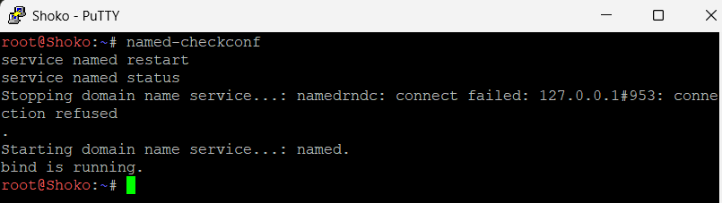

#### Verifikasi Zone Transfer ke Shoko

**Node: `shoko`**

Periksa apakah file zona telah tersedia pada direktori cache.

```bash
ls -l /var/cache/bind/jujutsu.K-06.com
```

Keberadaan file zona menjadi salah satu bukti bahwa salinan zona tersimpan pada Slave. Verifikasi berikutnya dilakukan dengan memeriksa SOA record dan serial zona.

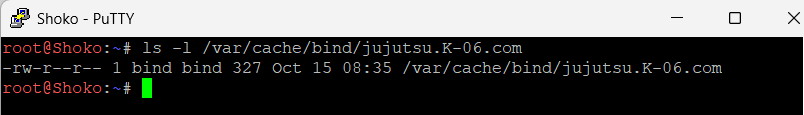

#### Verifikasi SOA pada Master dan Slave

**Node: `utahime`**

```bash
dig SOA jujutsu.K-06.com @192.214.1.2
```

**Node: `shoko`**

```bash
dig SOA jujutsu.K-06.com @192.214.1.3
```

Periksa status respons dan serial pada bagian `ANSWER SECTION`. Jika kedua server memberikan status `NOERROR` dengan serial yang sama, keduanya menyajikan versi zona yang sama.

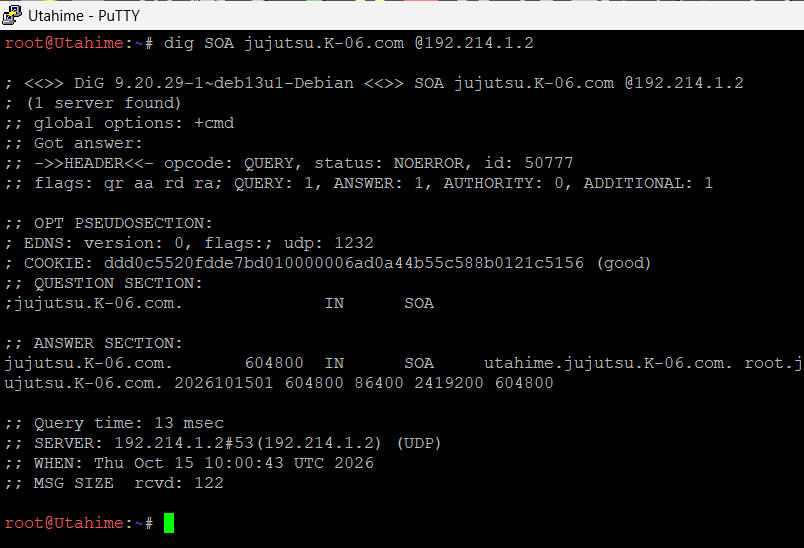


#### Uji Sinkronisasi dengan Kenaikan Serial

**Node: `utahime`**

Ubah serial zona dari `2026101501` menjadi `2026101502`, lalu validasi dan muat ulang zona.

```bash
sed -i 's/2026101501/2026101502/' /etc/bind/zones/jujutsu.K-06.com
named-checkzone jujutsu.K-06.com /etc/bind/zones/jujutsu.K-06.com
rndc reload jujutsu.K-06.com
```

Pastikan validasi zona menghasilkan `OK` dan perintah reload berhasil diproses.

**Node: `shoko`**

Periksa serial zona setelah proses sinkronisasi.

```bash
dig SOA jujutsu.K-06.com @192.214.1.3 +short
```

Serial yang diharapkan setelah sinkronisasi adalah `2026101502`.

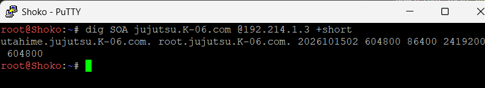

Jika serial pada Shoko telah berubah menjadi `2026101502`, perubahan zona pada Master telah diterapkan pada Slave.

#### Bukti Query dari Client

**Node: salah satu klien, misalnya `itadori`**

Uji resolusi nama host melalui DNS Master dan DNS Slave.

##### Query nama Utahime melalui Master

```bash
dig utahime.jujutsu.K-06.com A @192.214.1.2
```

Alamat IP yang diharapkan adalah `192.214.1.2`.

##### Query nama Utahime melalui Slave

```bash
dig utahime.jujutsu.K-06.com A @192.214.1.3
```

Alamat IP yang diharapkan adalah `192.214.1.2`.

##### Query nama Shoko melalui Master

```bash
dig shoko.jujutsu.K-06.com A @192.214.1.2
```

Alamat IP yang diharapkan adalah `192.214.1.3`.

##### Query nama Shoko melalui Slave

```bash
dig shoko.jujutsu.K-06.com A @192.214.1.3
```

Alamat IP yang diharapkan adalah `192.214.1.3`.


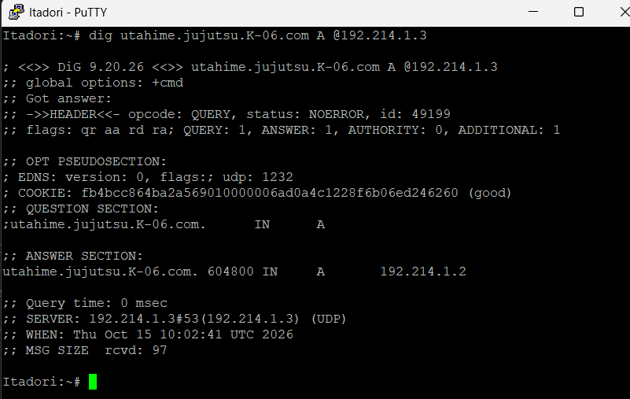


Keempat pengujian tersebut membuktikan bahwa DNS Master dan Slave dapat menjawab permintaan resolusi untuk nama host yang telah didefinisikan dalam zona. Query menggunakan nama host dipilih karena zona saat ini belum memiliki A record untuk nama domain `jujutsu.K-06.com` itu sendiri.

#### Script Lengkap

##### Script DNS Master pada Utahime

Script berikut disimpan di node `Utahime` sebagai `soal11.sh`:

```bash
#!/bin/bash
set -e

apt-get update
apt-get install -y bind9 bind9utils bind9-doc

cat > /etc/bind/named.conf.local << 'EOF'
zone "jujutsu.K-06.com" {
    type master;
    file "/etc/bind/zones/jujutsu.K-06.com";
    allow-transfer { 192.214.1.3; };
};
EOF

cat > /etc/bind/named.conf.options << 'EOF'
options {
    directory "/var/cache/bind";
    allow-query { any; };
    recursion yes;
    forwarders {
        192.168.122.1;
    };
    dnssec-validation no;
    listen-on-v6 { any; };
};
EOF

mkdir -p /etc/bind/zones

cat > /etc/bind/zones/jujutsu.K-06.com << 'EOF'
$TTL 604800
@ IN SOA utahime.jujutsu.K-06.com. root.jujutsu.K-06.com. (
    2026101501 ; Serial
    604800     ; Refresh
    86400      ; Retry
    2419200    ; Expire
    604800 )   ; Negative Cache TTL

; NS Records
@ IN NS utahime.jujutsu.K-06.com.
@ IN NS shoko.jujutsu.K-06.com.

; A Records
utahime IN A 192.214.1.2
shoko   IN A 192.214.1.3
EOF

named-checkconf
named-checkzone jujutsu.K-06.com /etc/bind/zones/jujutsu.K-06.com
service named restart
service named status
```

##### Script DNS Slave pada Shoko

Script berikut disimpan di node `Shoko` sebagai `soal11.sh`:

```bash
#!/bin/bash
set -e

apt-get update
apt-get install -y bind9 bind9utils bind9-doc

cat > /etc/bind/named.conf.local << 'EOF'
zone "jujutsu.K-06.com" {
    type slave;
    file "/var/cache/bind/jujutsu.K-06.com";
    masters { 192.214.1.2; };
};
EOF

cat > /etc/bind/named.conf.options << 'EOF'
options {
    directory "/var/cache/bind";
    allow-query { any; };
    recursion yes;
    forwarders {
        192.168.122.1;
    };
    dnssec-validation no;
    listen-on-v6 { any; };
};
EOF

named-checkconf
service named restart
service named status
```

### 12 - Konfigurasi DNS Record, Reverse DNS, dan DNS Forwarder

Soal 12 meminta DNS pada node `utahime` dikonfigurasi agar domain `jujutsu.K-06.com` memiliki A record yang mengarah ke Gojo dan CNAME `www` yang merujuk ke domain utama. Reverse DNS juga dikonfigurasi menggunakan record PTR agar alamat IP Gojo dapat ditelusuri kembali ke nama domainnya. Selain itu, DNS Forwarder diaktifkan pada BIND9 untuk meneruskan permintaan resolusi domain eksternal melalui gateway internet `192.168.122.1`.

#### Konfigurasi Forward Zone pada Utahime

Node: `utahime` (`192.214.1.2`)

File: `/etc/bind/db.jujutsu.K-06.com`

Catatan: soal 11 menulis zona ke `/etc/bind/zones/jujutsu.K-06.com`. Pada soal 12, zona ditulis ulang ke `/etc/bind/db.jujutsu.K-06.com`, dan deklarasi `zone "jujutsu.K-06.com"` pada `named.conf.local` diarahkan ke file tersebut.

Forward zone digunakan untuk memetakan nama domain ke alamat IP. Record NS menetapkan server DNS yang berwenang atas zona, sedangkan record A memetakan nama host ke alamat IPv4. Record CNAME menjadikan `www.jujutsu.K-06.com` sebagai alias dari domain utama.

Konfigurasi record yang digunakan:

    @       IN NS    utahime.jujutsu.K-06.com.
    @       IN NS    shoko.jujutsu.K-06.com.
    utahime IN A     192.214.1.2
    shoko   IN A     192.214.1.3
    gojo    IN A     192.214.1.4
    @       IN A     192.214.1.4
    www     IN CNAME jujutsu.K-06.com.

#### Konfigurasi Reverse DNS

Node: `utahime`

File: `/etc/bind/db.reverse.192.214.1`

Reverse DNS digunakan untuk memetakan alamat IP kembali ke nama domain. Zona reverse yang digunakan adalah `1.214.192.in-addr.arpa`. Record PTR ditambahkan agar alamat IP `192.214.1.4` dapat di-resolve menjadi `gojo.jujutsu.K-06.com.`.

Record PTR yang digunakan:

    4 IN PTR gojo.jujutsu.K-06.com.

Deklarasi zona reverse ditambahkan pada `/etc/bind/named.conf.local`:

    zone "1.214.192.in-addr.arpa" {
        type master;
        file "/etc/bind/db.reverse.192.214.1";
    };

#### Konfigurasi DNS Forwarder

Node: `utahime`

File: `/etc/bind/named.conf.options`

DNS Forwarder diaktifkan agar BIND9 dapat meneruskan permintaan DNS eksternal ke gateway internet `192.168.122.1`. Opsi `recursion yes` mengizinkan server melakukan pencarian DNS rekursif untuk domain di luar zona lokal.

Konfigurasi yang digunakan:

    options {
        directory "/var/cache/bind";
        allow-query { any; };
        recursion yes;

        forwarders {
            192.168.122.1;
        };

        dnssec-validation no;
        listen-on-v6 { any; };
    };


Gambar di atas menunjukkan konfigurasi BIND9 yang mengaktifkan recursive query dan menggunakan `192.168.122.1` sebagai DNS Forwarder.

#### Validasi Konfigurasi BIND9

Setelah file konfigurasi dibuat, validasi dilakukan menggunakan `named-checkconf` untuk memeriksa sintaks konfigurasi BIND9 serta `named-checkzone` untuk memeriksa file forward zone dan reverse zone.

    named-checkconf
    named-checkzone jujutsu.K-06.com /etc/bind/db.jujutsu.K-06.com
    named-checkzone 1.214.192.in-addr.arpa /etc/bind/db.reverse.192.214.1

Hasil pemeriksaan menunjukkan bahwa forward zone dan reverse zone berhasil dimuat dengan serial `2026101502` dan status `OK`. Setelah validasi selesai, layanan DNS dijalankan ulang:

    service named restart


Hasil validasi menunjukkan bahwa kedua file zona dapat dimuat tanpa error dan layanan BIND9 berhasil dijalankan ulang.

#### Pengujian A Record

Pengujian A record dilakukan untuk memeriksa alamat IPv4 yang dikembalikan oleh DNS untuk nama host Gojo.

    dig @127.0.0.1 gojo.jujutsu.K-06.com A +short
    dig @127.0.0.1 jujutsu.K-06.com A +short

Perintah tersebut digunakan untuk memastikan bahwa nama host Gojo dapat di-resolve melalui DNS lokal Utahime.

#### Pengujian CNAME

Pengujian CNAME dilakukan untuk memastikan bahwa `www.jujutsu.K-06.com` merujuk ke domain utama.

    dig @127.0.0.1 www.jujutsu.K-06.com CNAME +short

Hasil pengujian:

    jujutsu.K-06.com.


Hasil tersebut menunjukkan bahwa record `www` berhasil mengarah ke `jujutsu.K-06.com.` melalui CNAME.

#### Pengujian Reverse DNS

Pengujian Reverse DNS dilakukan menggunakan alamat IP yang telah dikonfigurasi pada record PTR.

    dig @127.0.0.1 -x 192.214.1.4 +short

Hasil pengujian:

    gojo.jujutsu.K-06.com.

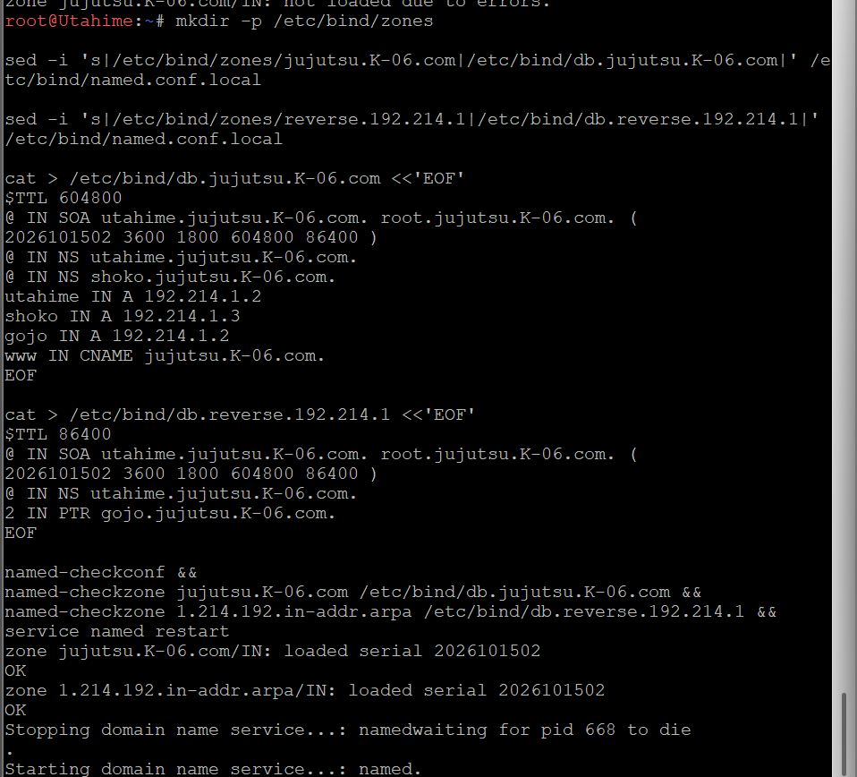

Hasil tersebut menunjukkan bahwa alamat IP `192.214.1.4` berhasil dipetakan kembali ke nama domain Gojo melalui record PTR.

#### Pengujian DNS Eksternal dan Konektivitas

Pengujian DNS Forwarder dilakukan dengan meminta alamat IPv4 domain eksternal melalui DNS lokal Utahime.

    dig @127.0.0.1 google.com A +short

Hasil pengujian menghasilkan beberapa alamat IPv4 untuk `google.com`, yang menunjukkan bahwa resolusi domain eksternal berhasil dilakukan pada saat pengujian.

Selanjutnya, konektivitas ke domain eksternal diuji menggunakan:

    ping -c 4 google.com


Hasil pengujian menunjukkan empat paket dikirim dan empat paket diterima dengan packet loss sebesar `0%`. Hal ini membuktikan bahwa resolusi nama domain dan konektivitas ke `google.com` berhasil pada saat pengujian.

#### Status Persistence

Persistensi konfigurasi setelah node GNS3 dihentikan dan dijalankan kembali belum diverifikasi. Oleh karena itu, pengujian restart node masih diperlukan untuk memastikan file konfigurasi tetap tersedia dan layanan DNS dapat berjalan kembali tanpa konfigurasi ulang secara manual.

#### Script Lengkap

Script berikut disimpan di node `Utahime` sebagai `soal12.sh`:

```bash
#!/bin/bash

apt-get update
DEBIAN_FRONTEND=noninteractive apt-get install -y bind9 bind9utils bind9-doc

cat > /etc/bind/named.conf.local << 'EOF'
zone "jujutsu.K-06.com" {
    type master;
    file "/etc/bind/db.jujutsu.K-06.com";
    allow-transfer { 192.214.1.3; };
};

zone "1.214.192.in-addr.arpa" {
    type master;
    file "/etc/bind/db.reverse.192.214.1";
};
EOF

cat > /etc/bind/named.conf.options << 'EOF'
options {
    directory "/var/cache/bind";
    allow-query { any; };
    recursion yes;

    forwarders {
        192.168.122.1;
    };

    dnssec-validation no;
    listen-on-v6 { any; };
};
EOF

cat > /etc/bind/db.jujutsu.K-06.com << 'EOF'
$TTL 604800
@ IN SOA utahime.jujutsu.K-06.com. root.jujutsu.K-06.com. (
    2026101502 ; Serial
    604800     ; Refresh
    86400      ; Retry
    2419200    ; Expire
    604800 )   ; Negative Cache TTL

; NS Records
@ IN NS utahime.jujutsu.K-06.com.
@ IN NS shoko.jujutsu.K-06.com.

; A Records
utahime IN A 192.214.1.2
shoko   IN A 192.214.1.3
gojo    IN A 192.214.1.4
@       IN A 192.214.1.4

; CNAME Record
www IN CNAME jujutsu.K-06.com.
EOF

cat > /etc/bind/db.reverse.192.214.1 << 'EOF'
$TTL 604800
@ IN SOA utahime.jujutsu.K-06.com. root.jujutsu.K-06.com. (
    2026101502 ; Serial
    604800     ; Refresh
    86400      ; Retry
    2419200    ; Expire
    604800 )   ; Negative Cache TTL

@ IN NS utahime.jujutsu.K-06.com.

; PTR Record
4 IN PTR gojo.jujutsu.K-06.com.
EOF

named-checkconf
named-checkzone jujutsu.K-06.com /etc/bind/db.jujutsu.K-06.com
named-checkzone 1.214.192.in-addr.arpa /etc/bind/db.reverse.192.214.1
service named restart
service named status
```

### 13 - Konfigurasi MariaDB Master-Slave Replication

Soal 13 meminta konfigurasi database terpusat dengan mekanisme replikasi antara node `yaga` sebagai **DB-Master** dan node `inumaki` sebagai **DB-Slave**. Database yang digunakan adalah `db_shibuya_K-06` dengan tabel `request_logs`. Replikasi dilakukan menggunakan binary logging pada Master dan mekanisme `CHANGE MASTER TO` pada Slave agar perubahan data di Master dapat disalin secara otomatis ke Slave.

#### Konfigurasi MariaDB pada Yaga sebagai DB-Master

Node: `yaga` (`192.214.4.41`)

File konfigurasi: `/etc/mysql/mariadb.conf.d/50-server.cnf`

Pada node Yaga, MariaDB dikonfigurasi menggunakan `server-id = 41` sebagai identitas unik server database. Binary logging diaktifkan melalui parameter `log_bin` agar setiap perubahan data dapat dicatat dan dikirimkan kepada Slave. Format binary log menggunakan `ROW`, sehingga perubahan data direkam berdasarkan perubahan pada baris tabel.

Konfigurasi yang digunakan:

```ini
[mysqld]
bind-address = 0.0.0.0
server-id = 41
log_bin = /var/log/mysql/mariadb-bin
binlog_format = ROW
expire_logs_days = 10
```

Parameter `bind-address = 0.0.0.0` memungkinkan MariaDB menerima koneksi melalui seluruh antarmuka jaringan. Parameter `expire_logs_days = 10` mengatur masa penyimpanan binary log selama sepuluh hari.

Direktori binary log dipersiapkan agar MariaDB dapat membuat file log dengan izin akses yang sesuai:

```bash
mkdir -p /var/log/mysql
chown mysql:mysql /var/log/mysql
chmod 750 /var/log/mysql
service mariadb restart
```

Setelah layanan dijalankan ulang, konfigurasi diperiksa menggunakan:

```bash
mariadb -e "SHOW GLOBAL VARIABLES LIKE 'server_id'; SHOW GLOBAL VARIABLES LIKE 'log_bin';"
```

Hasil pemeriksaan menunjukkan bahwa `server_id` bernilai `41` dan `log_bin` bernilai `ON`. Hal ini membuktikan bahwa identitas server Master telah ditetapkan dan binary logging berhasil diaktifkan.


#### Pembuatan Database dan Tabel request_logs

Node: `yaga` sebagai DB-Master.

Database `db_shibuya_K-06` dibuat sebagai tempat penyimpanan log aktivitas. Di dalamnya dibuat tabel `request_logs` yang menyimpan identitas sumber aktivitas, jenis tindakan, detail aktivitas, dan waktu pencatatan.

Struktur tabel yang digunakan:

```sql
CREATE DATABASE IF NOT EXISTS `db_shibuya_K-06`;

USE `db_shibuya_K-06`;

CREATE TABLE IF NOT EXISTS request_logs (
    id INT AUTO_INCREMENT PRIMARY KEY,
    source_node VARCHAR(50) NOT NULL,
    action VARCHAR(100) NOT NULL,
    details TEXT,
    created_at TIMESTAMP DEFAULT CURRENT_TIMESTAMP
);
```

Kolom `id` digunakan sebagai primary key dengan nilai yang bertambah otomatis. Kolom `source_node` menyimpan nama node sumber aktivitas, `action` menyimpan jenis aktivitas, `details` menyimpan keterangan tambahan, dan `created_at` mencatat waktu data dibuat.

Keberadaan database dan tabel diverifikasi menggunakan:

```sql
SHOW MASTER STATUS;
SHOW DATABASES LIKE 'db_shibuya_K-06';
SHOW TABLES FROM `db_shibuya_K-06`;
```

Hasil pemeriksaan menunjukkan bahwa database `db_shibuya_K-06` dan tabel `request_logs` tersedia pada Yaga.

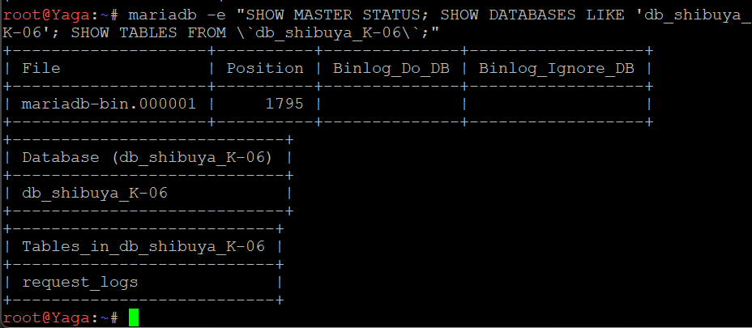

#### Pembuatan Akun Replikasi dan Pemberian Hak Akses

Node: `yaga` sebagai DB-Master.

Akun khusus bernama `replicator` dibuat untuk digunakan oleh Inumaki saat mengakses Master. Host akun dibatasi pada pola `192.214.4.%`, sehingga akun tersebut dapat digunakan dari alamat IP dalam subnet Network 4 yang sesuai dengan pola tersebut.

Perintah yang digunakan:

```sql
CREATE USER IF NOT EXISTS 'replicator'@'192.214.4.%'
IDENTIFIED BY 'ReplK06_StrongPass!';

GRANT REPLICATION SLAVE ON *.*
TO 'replicator'@'192.214.4.%';

FLUSH PRIVILEGES;
```

Hak `REPLICATION SLAVE` memberikan izin yang diperlukan agar akun dapat membaca binary log Master untuk proses replikasi. Perintah `FLUSH PRIVILEGES` digunakan untuk memuat perubahan hak akses.

Konfigurasi akses remote pada MariaDB juga diperiksa menggunakan:

```sql
SHOW GLOBAL VARIABLES LIKE 'bind_address';
SHOW GLOBAL VARIABLES LIKE 'port';
SHOW GRANTS FOR 'replicator'@'192.214.4.%';
```

Hasil pemeriksaan menunjukkan bahwa `bind_address` bernilai `0.0.0.0`, MariaDB menggunakan port `3306`, dan akun `replicator` memiliki hak `REPLICATION SLAVE`.


#### Konfigurasi MariaDB pada Inumaki sebagai DB-Slave

Node: `inumaki` (`192.214.4.42`)

File konfigurasi: `/etc/mysql/mariadb.conf.d/50-server.cnf`

Pada node Inumaki, MariaDB dikonfigurasi sebagai Slave dengan `server-id = 42`. Nilai ini dibuat berbeda dari Master untuk menghindari konflik identitas antarserver. Parameter `relay-log` digunakan untuk menentukan lokasi file relay log yang menyimpan event replikasi yang diterima dari Master sebelum diterapkan ke database lokal.

Konfigurasi yang digunakan:

```ini
[mysqld]
bind-address = 0.0.0.0
server-id = 42
relay-log = /var/log/mysql/mariadb-relay-bin
```

Direktori log dipersiapkan dan layanan MariaDB dijalankan ulang:

```bash
mkdir -p /var/log/mysql
chown mysql:mysql /var/log/mysql
chmod 750 /var/log/mysql
service mariadb restart
```

Identitas Slave diverifikasi menggunakan:

```bash
mariadb -e "SHOW GLOBAL VARIABLES LIKE 'server_id';"
```

Hasil pemeriksaan menunjukkan bahwa `server_id` pada Inumaki bernilai `42`.

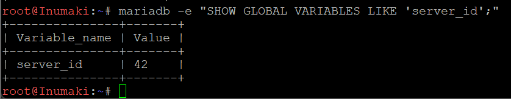

#### Pengujian Konektivitas antara Slave dan Master

Sebelum mengaktifkan replikasi, konektivitas jaringan dari Inumaki ke Yaga diperiksa menggunakan `ping` dan `nc`.

```bash
ping -c 4 192.214.4.41
nc -vz 192.214.4.41 3306
```

Perintah `ping` digunakan untuk memeriksa keterjangkauan alamat IP Master. Sementara itu, `nc -vz` digunakan untuk memastikan bahwa port TCP `3306` pada Yaga dapat dijangkau dari Inumaki.

Hasil pengujian menunjukkan bahwa empat paket ICMP berhasil diterima tanpa packet loss dan koneksi ke port `3306` berhasil dibuka. Dengan demikian, konektivitas jaringan dan akses ke port MariaDB antara kedua node telah terverifikasi.


#### Konfigurasi Replikasi Menggunakan CHANGE MASTER TO

Node: `inumaki` sebagai DB-Slave.

Replikasi dikonfigurasi dengan menghubungkan Inumaki ke alamat IP Yaga. File binary log dan posisi log yang digunakan mengikuti hasil `SHOW MASTER STATUS` pada Yaga, yaitu `mariadb-bin.000001` dengan posisi awal `1323` saat konfigurasi awal dilakukan.

Perintah konfigurasi yang digunakan:

```sql
STOP SLAVE;

CHANGE MASTER TO
    MASTER_HOST = '192.214.4.41',
    MASTER_USER = 'replicator',
    MASTER_PASSWORD = 'ReplK06_StrongPass!',
    MASTER_PORT = 3306,
    MASTER_LOG_FILE = 'mariadb-bin.000001',
    MASTER_LOG_POS = 1323;

START SLAVE;
```

Perintah `STOP SLAVE` menghentikan proses replikasi sebelumnya jika ada. `CHANGE MASTER TO` menetapkan alamat Master, akun autentikasi, port, serta posisi binary log yang menjadi titik awal pembacaan. Setelah itu, `START SLAVE` memulai proses replikasi.

Status replikasi diperiksa menggunakan:

```sql
SHOW SLAVE STATUS\G
```

Pada pemeriksaan awal, `Slave_IO_Running` menunjukkan `Connecting` dan `Slave_SQL_Running` menunjukkan `Yes`. Setelah koneksi dan proses replikasi berjalan, pemeriksaan berikutnya menunjukkan kedua status bernilai `Yes`.


#### Penanganan Error Replikasi dan Sinkronisasi Tabel

Pada pengujian awal, Slave menerima event dari Master, tetapi proses SQL berhenti karena tabel `db_shibuya_K-06.request_logs` belum tersedia di Inumaki. Hal ini terlihat dari pesan error `Table 'db_shibuya_K-06.request_logs' doesn't exist`.

Error tersebut menunjukkan bahwa koneksi replikasi telah menerima event, tetapi tabel tujuan belum tersedia ketika event akan diterapkan. Setelah tabel tersedia dan proses replikasi kembali berjalan, status diperiksa kembali menggunakan:

```bash
mariadb -e "SHOW SLAVE STATUS\G" | grep -E 'Slave_IO_Running|Slave_SQL_Running|Last_IO_Error|Last_SQL_Error|Master_Host|Master_User'
```

Hasil pemeriksaan akhir menunjukkan:

- `Master_Host: 192.214.4.41`
- `Master_User: replicator`
- `Slave_IO_Running: Yes`
- `Slave_SQL_Running: Yes`
- `Last_IO_Error` tidak menunjukkan error aktif.
- `Last_SQL_Error` tidak menunjukkan error aktif.

Kedua status replikasi yang bernilai `Yes` menunjukkan bahwa koneksi dari Slave ke Master aktif dan event replikasi dapat diterapkan oleh thread SQL.

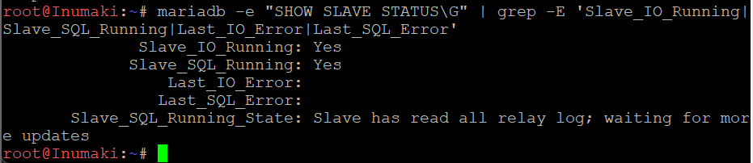

#### Pengujian Replikasi Data Secara Realtime

Pengujian dilakukan dengan memasukkan data baru ke tabel `request_logs` pada Yaga, kemudian memeriksa apakah data tersebut muncul pada Inumaki.

Perintah yang dijalankan pada Yaga:

```sql
USE `db_shibuya_K-06`;

INSERT INTO request_logs (source_node, action, details)
VALUES (
    'Yaga',
    'replication_test',
    'Nomor 13 - realtime replication test'
);

SELECT * FROM request_logs ORDER BY id DESC LIMIT 5;
```

Hasil pada Yaga menunjukkan bahwa data pengujian berhasil ditambahkan dengan `id = 1`, `source_node = Yaga`, `action = replication_test`, dan detail `Nomor 13 - realtime replication test`.

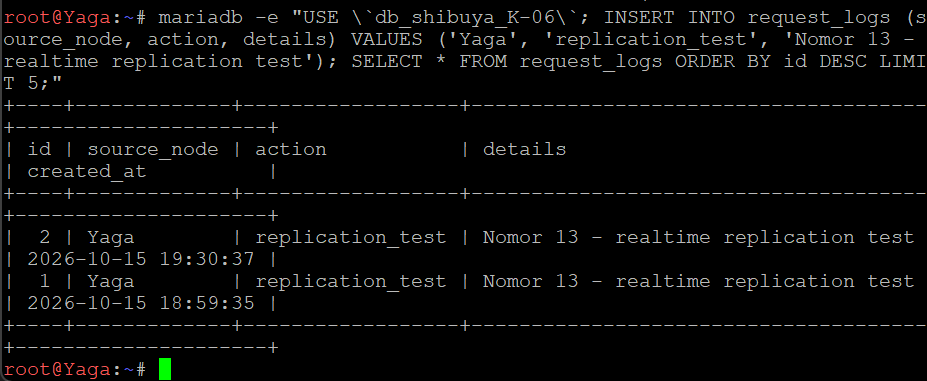

Selanjutnya, data diperiksa pada Inumaki menggunakan:

```sql
SELECT *
FROM `db_shibuya_K-06`.request_logs
ORDER BY id DESC
LIMIT 5;
```

Hasil pemeriksaan pada Inumaki menunjukkan bahwa data dengan `id = 1` dan detail pengujian yang sama telah tersedia pada tabel `request_logs`. Hal ini membuktikan bahwa perubahan data yang dilakukan pada Master berhasil direplikasi ke Slave.


Konfigurasi MariaDB Master-Slave pada node Yaga dan Inumaki berhasil dijalankan. Yaga menggunakan `server-id = 41` dan binary logging aktif, sedangkan Inumaki menggunakan `server-id = 42` sebagai Slave. Akun `replicator` telah diberikan hak replikasi, konektivitas TCP ke port `3306` berhasil diuji, dan status akhir menunjukkan `Slave_IO_Running = Yes` serta `Slave_SQL_Running = Yes`.

Pengujian dengan memasukkan data `replication_test` pada Yaga dan memeriksa data yang sama pada Inumaki membuktikan bahwa replikasi data berjalan. Dengan demikian, persyaratan utama Soal 13 mengenai konfigurasi Master-Slave dan pembuktian replikasi data telah terpenuhi.

#### Script Lengkap

Script berikut disimpan di node `Yaga` sebagai `soal13.sh`:


```bash
#!/bin/bash

apt-get update
DEBIAN_FRONTEND=noninteractive apt-get install -y mariadb-server mariadb-client

cat > /etc/mysql/mariadb.conf.d/50-server.cnf << 'EOF'
[mysqld]
bind-address = 0.0.0.0
server-id = 41
log_bin = /var/log/mysql/mariadb-bin
binlog_format = ROW
expire_logs_days = 10
EOF

mkdir -p /var/log/mysql
chown mysql:mysql /var/log/mysql
chmod 750 /var/log/mysql
service mariadb restart

mariadb << 'EOF'
CREATE DATABASE IF NOT EXISTS `db_shibuya_K-06`;

USE `db_shibuya_K-06`;

CREATE TABLE IF NOT EXISTS request_logs (
    id INT AUTO_INCREMENT PRIMARY KEY,
    source_node VARCHAR(50) NOT NULL,
    action VARCHAR(100) NOT NULL,
    details TEXT,
    created_at TIMESTAMP DEFAULT CURRENT_TIMESTAMP
);

CREATE USER IF NOT EXISTS 'replicator'@'192.214.4.%' IDENTIFIED BY 'ReplK06_StrongPass!';
GRANT REPLICATION SLAVE ON *.* TO 'replicator'@'192.214.4.%';
FLUSH PRIVILEGES;

SHOW MASTER STATUS;
EOF
```

##### Script DB-Slave pada Inumaki

Script berikut disimpan di node `Utahime` sebagai `soal13.sh`:

```bash
#!/bin/bash
# Soal 13 - MariaDB DB-Slave. Simpan di /root/soal13.sh

# Lewati kalau replikasi sudah terkonfigurasi.
mariadb -e "SHOW SLAVE STATUS\G" 2>/dev/null | grep -q 'Master_Host: 192.214.4.41' && exit 0

apt-get update
DEBIAN_FRONTEND=noninteractive apt-get install -y mariadb-server mariadb-client

cat > /etc/mysql/mariadb.conf.d/50-server.cnf << 'EOF'
[mysqld]
bind-address = 0.0.0.0
server-id = 42
relay-log = /var/log/mysql/mariadb-relay-bin
EOF

mkdir -p /var/log/mysql
chown mysql:mysql /var/log/mysql
chmod 750 /var/log/mysql
service mariadb restart

# Tunggu master yaga siap di jaringan.
until ping -c 1 192.214.4.41 >/dev/null 2>&1; do
    echo "Menunggu yaga..."; sleep 3
done

# Samakan struktur tabel agar event replikasi tidak gagal
# (menghindari error "Table 'db_shibuya_K-06.request_logs' doesn't exist").
mariadb << 'EOF'
CREATE DATABASE IF NOT EXISTS `db_shibuya_K-06`;

USE `db_shibuya_K-06`;

CREATE TABLE IF NOT EXISTS request_logs (
    id INT AUTO_INCREMENT PRIMARY KEY,
    source_node VARCHAR(50) NOT NULL,
    action VARCHAR(100) NOT NULL,
    details TEXT,
    created_at TIMESTAMP DEFAULT CURRENT_TIMESTAMP
);
EOF

# Hubungkan slave ke master.
mariadb << 'EOF'
STOP SLAVE;

CHANGE MASTER TO
    MASTER_HOST = '192.214.4.41',
    MASTER_USER = 'replicator',
    MASTER_PASSWORD = 'ReplK06_StrongPass!',
    MASTER_PORT = 3306,
    MASTER_LOG_FILE = 'mariadb-bin.000001',
    MASTER_LOG_POS = 1323;

START SLAVE;
EOF

mariadb -e "SHOW SLAVE STATUS\G" | grep -E 'Slave_IO_Running|Slave_SQL_Running|Last_IO_Error|Last_SQL_Error|Master_Host|Master_User'
```
