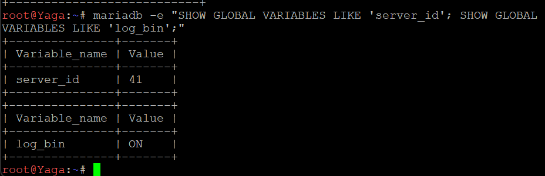
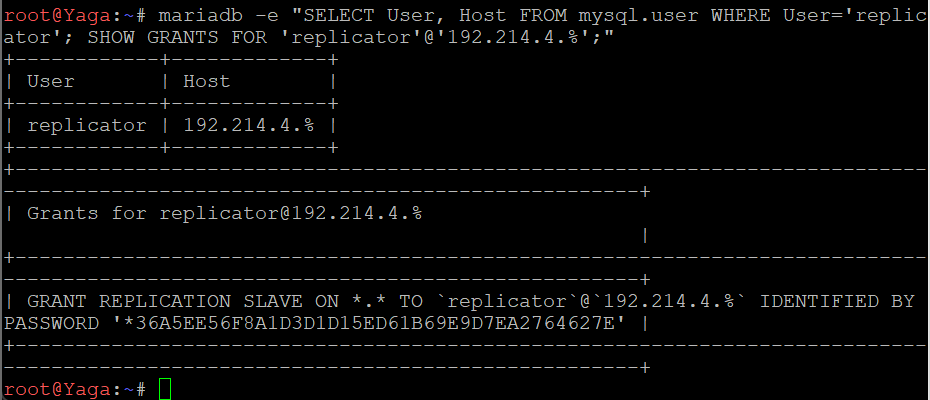
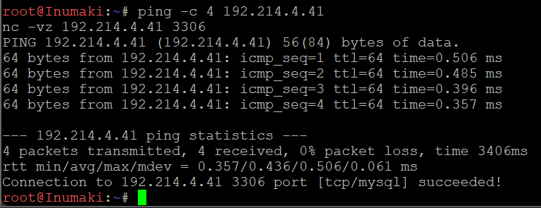
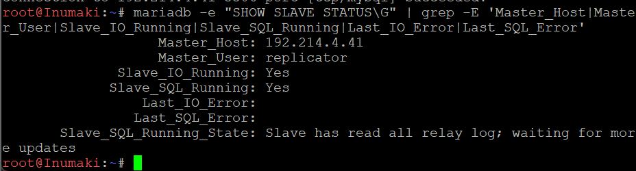
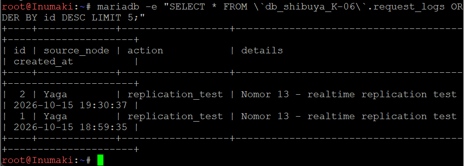

### 12 - Konfigurasi DNS Record, Reverse DNS, dan DNS Forwarder

Soal 12 meminta DNS pada node `utahime` dikonfigurasi agar domain `jujutsu.K-06.com` memiliki A record yang mengarah ke Gojo dan CNAME `www` yang merujuk ke domain utama. Reverse DNS juga dikonfigurasi menggunakan record PTR agar alamat IP Gojo dapat ditelusuri kembali ke nama domainnya. Selain itu, DNS Forwarder diaktifkan pada BIND9 untuk meneruskan permintaan resolusi domain eksternal melalui gateway internet `192.168.122.1`.

#### Konfigurasi Forward Zone pada Utahime

Node: `utahime` (`192.214.1.2`)

File: `/etc/bind/db.jujutsu.K-06.com`

Forward zone digunakan untuk memetakan nama domain ke alamat IP. Record NS menetapkan server DNS yang berwenang atas zona, sedangkan record A memetakan nama host ke alamat IPv4. Record CNAME menjadikan `www.jujutsu.K-06.com` sebagai alias dari domain utama.

Konfigurasi record yang digunakan:

    @       IN NS    utahime.jujutsu.K-06.com.
    @       IN NS    shoko.jujutsu.K-06.com.
    utahime IN A     192.214.1.2
    shoko   IN A     192.214.1.3
    gojo    IN A     192.214.1.2
    www     IN CNAME jujutsu.K-06.com.

#### Konfigurasi Reverse DNS

Node: `utahime`

File: `/etc/bind/db.reverse.192.214.1`

Reverse DNS digunakan untuk memetakan alamat IP kembali ke nama domain. Zona reverse yang digunakan adalah `1.214.192.in-addr.arpa`. Record PTR ditambahkan agar alamat IP `192.214.1.2` dapat di-resolve menjadi `gojo.jujutsu.K-06.com.`.

Record PTR yang digunakan:

    2 IN PTR gojo.jujutsu.K-06.com.

Deklarasi zona reverse ditambahkan pada `/etc/bind/named.conf.local`:

    zone "1.214.192.in-addr.arpa" {
        type master;
        file "/etc/bind/db.reverse.192.214.1";
    };

#### Konfigurasi DNS Forwarder

Node: `utahime`

File: `/etc/bind/named.conf.options`

DNS Forwarder diaktifkan agar BIND9 dapat meneruskan permintaan DNS eksternal ke gateway internet `192.168.122.1`. Opsi `recursion yes` mengizinkan server melakukan pencarian DNS rekursif untuk domain di luar zona lokal.

Konfigurasi yang digunakan:

    options {
        directory "/var/cache/bind";
        allow-query { any; };
        recursion yes;

        forwarders {
            192.168.122.1;
        };

        dnssec-validation no;
        listen-on-v6 { any; };
    };


Gambar di atas menunjukkan konfigurasi BIND9 yang mengaktifkan recursive query dan menggunakan `192.168.122.1` sebagai DNS Forwarder.

#### Validasi Konfigurasi BIND9

Setelah file konfigurasi dibuat, validasi dilakukan menggunakan `named-checkconf` untuk memeriksa sintaks konfigurasi BIND9 serta `named-checkzone` untuk memeriksa file forward zone dan reverse zone.

    named-checkconf
    named-checkzone jujutsu.K-06.com /etc/bind/db.jujutsu.K-06.com
    named-checkzone 1.214.192.in-addr.arpa /etc/bind/db.reverse.192.214.1

Hasil pemeriksaan menunjukkan bahwa forward zone dan reverse zone berhasil dimuat dengan serial `2026101502` dan status `OK`. Setelah validasi selesai, layanan DNS dijalankan ulang:

    service named restart


Hasil validasi menunjukkan bahwa kedua file zona dapat dimuat tanpa error dan layanan BIND9 berhasil dijalankan ulang.

#### Pengujian A Record

Pengujian A record dilakukan untuk memeriksa alamat IPv4 yang dikembalikan oleh DNS untuk nama host Gojo.

    dig @127.0.0.1 gojo.jujutsu.K-06.com A +short

Perintah tersebut digunakan untuk memastikan bahwa nama host Gojo dapat di-resolve melalui DNS lokal Utahime.

#### Pengujian CNAME

Pengujian CNAME dilakukan untuk memastikan bahwa `www.jujutsu.K-06.com` merujuk ke domain utama.

    dig @127.0.0.1 www.jujutsu.K-06.com CNAME +short

Hasil pengujian:

    jujutsu.K-06.com.


Hasil tersebut menunjukkan bahwa record `www` berhasil mengarah ke `jujutsu.K-06.com.` melalui CNAME.

#### Pengujian Reverse DNS

Pengujian Reverse DNS dilakukan menggunakan alamat IP yang telah dikonfigurasi pada record PTR.

    dig @127.0.0.1 -x 192.214.1.2 +short

Hasil pengujian:

    gojo.jujutsu.K-06.com.


Hasil tersebut menunjukkan bahwa alamat IP `192.214.1.2` berhasil dipetakan kembali ke nama domain Gojo melalui record PTR.

#### Pengujian DNS Eksternal dan Konektivitas

Pengujian DNS Forwarder dilakukan dengan meminta alamat IPv4 domain eksternal melalui DNS lokal Utahime.

    dig @127.0.0.1 google.com A +short

Hasil pengujian menghasilkan beberapa alamat IPv4 untuk `google.com`, yang menunjukkan bahwa resolusi domain eksternal berhasil dilakukan pada saat pengujian.

Selanjutnya, konektivitas ke domain eksternal diuji menggunakan:

    ping -c 4 google.com


Hasil pengujian menunjukkan empat paket dikirim dan empat paket diterima dengan packet loss sebesar `0%`. Hal ini membuktikan bahwa resolusi nama domain dan konektivitas ke `google.com` berhasil pada saat pengujian.

#### Status Persistence

Persistensi konfigurasi setelah node GNS3 dihentikan dan dijalankan kembali belum diverifikasi. Oleh karena itu, pengujian restart node masih diperlukan untuk memastikan file konfigurasi tetap tersedia dan layanan DNS dapat berjalan kembali tanpa konfigurasi ulang secara manual.

**### 13 - Konfigurasi MariaDB Master-Slave Replication**

Soal 13 meminta konfigurasi database terpusat dengan mekanisme replikasi antara node `yaga` sebagai **DB-Master** dan node `inumaki` sebagai **DB-Slave**. Database yang digunakan adalah `db_shibuya_K-06` dengan tabel `request_logs`. Replikasi dilakukan menggunakan binary logging pada Master dan mekanisme `CHANGE MASTER TO` pada Slave agar perubahan data di Master dapat disalin secara otomatis ke Slave.

**#### Konfigurasi MariaDB pada Yaga sebagai DB-Master**

Node: `yaga` (`192.214.4.41`)

File konfigurasi: `/etc/mysql/mariadb.conf.d/50-server.cnf`

Pada node Yaga, MariaDB dikonfigurasi menggunakan `server-id = 41` sebagai identitas unik server database. Binary logging diaktifkan melalui parameter `log_bin` agar setiap perubahan data dapat dicatat dan dikirimkan kepada Slave. Format binary log menggunakan `ROW`, sehingga perubahan data direkam berdasarkan perubahan pada baris tabel.

Konfigurasi yang digunakan:

```ini
[mysqld]
bind-address = 0.0.0.0
server-id = 41
log_bin = /var/log/mysql/mariadb-bin
binlog_format = ROW
expire_logs_days = 10
```

Parameter `bind-address = 0.0.0.0` memungkinkan MariaDB menerima koneksi melalui seluruh antarmuka jaringan. Parameter `expire_logs_days = 10` mengatur masa penyimpanan binary log selama sepuluh hari.

Direktori binary log dipersiapkan agar MariaDB dapat membuat file log dengan izin akses yang sesuai:

```bash
mkdir -p /var/log/mysql
chown mysql:mysql /var/log/mysql
chmod 750 /var/log/mysql
service mariadb restart
```

Setelah layanan dijalankan ulang, konfigurasi diperiksa menggunakan:

```bash
mariadb -e "SHOW GLOBAL VARIABLES LIKE 'server_id'; SHOW GLOBAL VARIABLES LIKE 'log_bin';"
```

Hasil pemeriksaan menunjukkan bahwa `server_id` bernilai `41` dan `log_bin` bernilai `ON`. Hal ini membuktikan bahwa identitas server Master telah ditetapkan dan binary logging berhasil diaktifkan.



**#### Pembuatan Database dan Tabel request_logs**

Node: `yaga` sebagai DB-Master.

Database `db_shibuya_K-06` dibuat sebagai tempat penyimpanan log aktivitas. Di dalamnya dibuat tabel `request_logs` yang menyimpan identitas sumber aktivitas, jenis tindakan, detail aktivitas, dan waktu pencatatan.

Struktur tabel yang digunakan:

```sql
CREATE DATABASE IF NOT EXISTS `db_shibuya_K-06`;

USE `db_shibuya_K-06`;

CREATE TABLE IF NOT EXISTS request_logs (
    id INT AUTO_INCREMENT PRIMARY KEY,
    source_node VARCHAR(50) NOT NULL,
    action VARCHAR(100) NOT NULL,
    details TEXT,
    created_at TIMESTAMP DEFAULT CURRENT_TIMESTAMP
);
```

Kolom `id` digunakan sebagai primary key dengan nilai yang bertambah otomatis. Kolom `source_node` menyimpan nama node sumber aktivitas, `action` menyimpan jenis aktivitas, `details` menyimpan keterangan tambahan, dan `created_at` mencatat waktu data dibuat.

Keberadaan database dan tabel diverifikasi menggunakan:

```sql
SHOW MASTER STATUS;
SHOW DATABASES LIKE 'db_shibuya_K-06';
SHOW TABLES FROM `db_shibuya_K-06`;
```

Hasil pemeriksaan menunjukkan bahwa database `db_shibuya_K-06` dan tabel `request_logs` tersedia pada Yaga.


**#### Pembuatan Akun Replikasi dan Pemberian Hak Akses**

Node: `yaga` sebagai DB-Master.

Akun khusus bernama `replicator` dibuat untuk digunakan oleh Inumaki saat mengakses Master. Host akun dibatasi pada pola `192.214.4.%`, sehingga akun tersebut dapat digunakan dari alamat IP dalam subnet Network 4 yang sesuai dengan pola tersebut.

Perintah yang digunakan:

```sql
CREATE USER IF NOT EXISTS 'replicator'@'192.214.4.%'
IDENTIFIED BY 'ReplK06_StrongPass!';

GRANT REPLICATION SLAVE ON *.*
TO 'replicator'@'192.214.4.%';

FLUSH PRIVILEGES;
```

Hak `REPLICATION SLAVE` memberikan izin yang diperlukan agar akun dapat membaca binary log Master untuk proses replikasi. Perintah `FLUSH PRIVILEGES` digunakan untuk memuat perubahan hak akses.

Konfigurasi akses remote pada MariaDB juga diperiksa menggunakan:

```sql
SHOW GLOBAL VARIABLES LIKE 'bind_address';
SHOW GLOBAL VARIABLES LIKE 'port';
SHOW GRANTS FOR 'replicator'@'192.214.4.%';
```

Hasil pemeriksaan menunjukkan bahwa `bind_address` bernilai `0.0.0.0`, MariaDB menggunakan port `3306`, dan akun `replicator` memiliki hak `REPLICATION SLAVE`.



**#### Konfigurasi MariaDB pada Inumaki sebagai DB-Slave**

Node: `inumaki` (`192.214.4.42`)

File konfigurasi: `/etc/mysql/mariadb.conf.d/50-server.cnf`

Pada node Inumaki, MariaDB dikonfigurasi sebagai Slave dengan `server-id = 42`. Nilai ini dibuat berbeda dari Master untuk menghindari konflik identitas antarserver. Parameter `relay-log` digunakan untuk menentukan lokasi file relay log yang menyimpan event replikasi yang diterima dari Master sebelum diterapkan ke database lokal.

Konfigurasi yang digunakan:

```ini
[mysqld]
bind-address = 0.0.0.0
server-id = 42
relay-log = /var/log/mysql/mariadb-relay-bin
```

Direktori log dipersiapkan dan layanan MariaDB dijalankan ulang:

```bash
mkdir -p /var/log/mysql
chown mysql:mysql /var/log/mysql
chmod 750 /var/log/mysql
service mariadb restart
```

Identitas Slave diverifikasi menggunakan:

```bash
mariadb -e "SHOW GLOBAL VARIABLES LIKE 'server_id';"
```

Hasil pemeriksaan menunjukkan bahwa `server_id` pada Inumaki bernilai `42`.


**#### Pengujian Konektivitas antara Slave dan Master**

Sebelum mengaktifkan replikasi, konektivitas jaringan dari Inumaki ke Yaga diperiksa menggunakan `ping` dan `nc`.

```bash
ping -c 4 192.214.4.41
nc -vz 192.214.4.41 3306
```

Perintah `ping` digunakan untuk memeriksa keterjangkauan alamat IP Master. Sementara itu, `nc -vz` digunakan untuk memastikan bahwa port TCP `3306` pada Yaga dapat dijangkau dari Inumaki.

Hasil pengujian menunjukkan bahwa empat paket ICMP berhasil diterima tanpa packet loss dan koneksi ke port `3306` berhasil dibuka. Dengan demikian, konektivitas jaringan dan akses ke port MariaDB antara kedua node telah terverifikasi.



**#### Konfigurasi Replikasi Menggunakan CHANGE MASTER TO**

Node: `inumaki` sebagai DB-Slave.

Replikasi dikonfigurasi dengan menghubungkan Inumaki ke alamat IP Yaga. File binary log dan posisi log yang digunakan mengikuti hasil `SHOW MASTER STATUS` pada Yaga, yaitu `mariadb-bin.000001` dengan posisi awal `1323` saat konfigurasi awal dilakukan.

Perintah konfigurasi yang digunakan:

```sql
STOP SLAVE;

CHANGE MASTER TO
    MASTER_HOST = '192.214.4.41',
    MASTER_USER = 'replicator',
    MASTER_PASSWORD = 'ReplK06_StrongPass!',
    MASTER_PORT = 3306,
    MASTER_LOG_FILE = 'mariadb-bin.000001',
    MASTER_LOG_POS = 1323;

START SLAVE;
```

Perintah `STOP SLAVE` menghentikan proses replikasi sebelumnya jika ada. `CHANGE MASTER TO` menetapkan alamat Master, akun autentikasi, port, serta posisi binary log yang menjadi titik awal pembacaan. Setelah itu, `START SLAVE` memulai proses replikasi.

Status replikasi diperiksa menggunakan:

```sql
SHOW SLAVE STATUS\G
```

Pada pemeriksaan awal, `Slave_IO_Running` menunjukkan `Connecting` dan `Slave_SQL_Running` menunjukkan `Yes`. Setelah koneksi dan proses replikasi berjalan, pemeriksaan berikutnya menunjukkan kedua status bernilai `Yes`.



**#### Penanganan Error Replikasi dan Sinkronisasi Tabel**

Pada pengujian awal, Slave menerima event dari Master, tetapi proses SQL berhenti karena tabel `db_shibuya_K-06.request_logs` belum tersedia di Inumaki. Hal ini terlihat dari pesan error `Table 'db_shibuya_K-06.request_logs' doesn't exist`.

Error tersebut menunjukkan bahwa koneksi replikasi telah menerima event, tetapi tabel tujuan belum tersedia ketika event akan diterapkan. Setelah tabel tersedia dan proses replikasi kembali berjalan, status diperiksa kembali menggunakan:

```bash
mariadb -e "SHOW SLAVE STATUS\G" | grep -E 'Slave_IO_Running|Slave_SQL_Running|Last_IO_Error|Last_SQL_Error|Master_Host|Master_User'
```

Hasil pemeriksaan akhir menunjukkan:

- `Master_Host: 192.214.4.41`
- `Master_User: replicator`
- `Slave_IO_Running: Yes`
- `Slave_SQL_Running: Yes`
- `Last_IO_Error` tidak menunjukkan error aktif.
- `Last_SQL_Error` tidak menunjukkan error aktif.

Kedua status replikasi yang bernilai `Yes` menunjukkan bahwa koneksi dari Slave ke Master aktif dan event replikasi dapat diterapkan oleh thread SQL.


**#### Pengujian Replikasi Data Secara Realtime**

Pengujian dilakukan dengan memasukkan data baru ke tabel `request_logs` pada Yaga, kemudian memeriksa apakah data tersebut muncul pada Inumaki.

Perintah yang dijalankan pada Yaga:

```sql
USE `db_shibuya_K-06`;

INSERT INTO request_logs (source_node, action, details)
VALUES (
    'Yaga',
    'replication_test',
    'Nomor 13 - realtime replication test'
);

SELECT * FROM request_logs ORDER BY id DESC LIMIT 5;
```

Hasil pada Yaga menunjukkan bahwa data pengujian berhasil ditambahkan dengan `id = 1`, `source_node = Yaga`, `action = replication_test`, dan detail `Nomor 13 - realtime replication test`.


Selanjutnya, data diperiksa pada Inumaki menggunakan:

```sql
SELECT *
FROM `db_shibuya_K-06`.request_logs
ORDER BY id DESC
LIMIT 5;
```

Hasil pemeriksaan pada Inumaki menunjukkan bahwa data dengan `id = 1` dan detail pengujian yang sama telah tersedia pada tabel `request_logs`. Hal ini membuktikan bahwa perubahan data yang dilakukan pada Master berhasil direplikasi ke Slave.



**#### Kesimpulan**

Konfigurasi MariaDB Master-Slave pada node Yaga dan Inumaki berhasil dijalankan. Yaga menggunakan `server-id = 41` dan binary logging aktif, sedangkan Inumaki menggunakan `server-id = 42` sebagai Slave. Akun `replicator` telah diberikan hak replikasi, konektivitas TCP ke port `3306` berhasil diuji, dan status akhir menunjukkan `Slave_IO_Running = Yes` serta `Slave_SQL_Running = Yes`.

Pengujian dengan memasukkan data `replication_test` pada Yaga dan memeriksa data yang sama pada Inumaki membuktikan bahwa replikasi data berjalan. Dengan demikian, persyaratan utama Soal 13 mengenai konfigurasi Master-Slave dan pembuktian replikasi data telah terpenuhi.

**#### Status Persistence**

Persistensi konfigurasi setelah node GNS3 dihentikan dan dijalankan kembali belum diverifikasi secara khusus. Oleh karena itu, diperlukan pengujian restart node untuk memastikan konfigurasi MariaDB, database, tabel, serta mekanisme replikasi tetap tersedia setelah node dijalankan kembali.