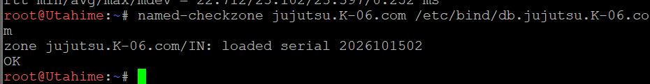
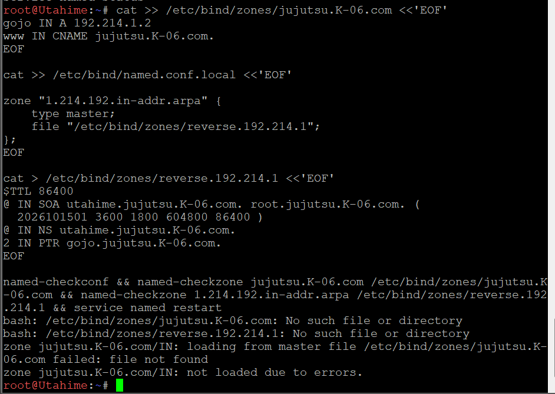
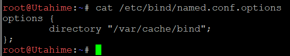
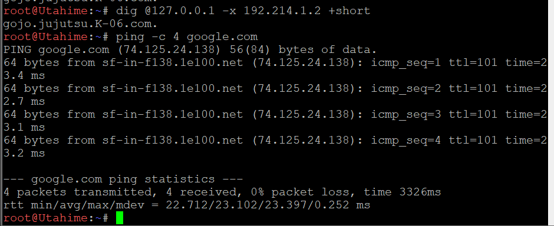

### 12 - Konfigurasi DNS Record, Reverse DNS, dan DNS Forwarder

Soal 12 meminta DNS pada node `utahime` dikonfigurasi agar domain `jujutsu.K-06.com` memiliki A record yang mengarah ke Gojo dan CNAME `www` yang merujuk ke domain utama. Reverse DNS juga dikonfigurasi menggunakan record PTR agar alamat IP Gojo dapat ditelusuri kembali ke nama domainnya. Selain itu, DNS Forwarder diaktifkan pada BIND9 untuk meneruskan permintaan resolusi domain eksternal melalui gateway internet `192.168.122.1`.

#### Konfigurasi Forward Zone pada Utahime

Node: `utahime` (`192.214.1.2`)

File: `/etc/bind/db.jujutsu.K-06.com`

Forward zone digunakan untuk memetakan nama domain ke alamat IP. Record NS menetapkan server DNS yang berwenang atas zona, sedangkan record A memetakan nama host ke alamat IPv4. Record CNAME menjadikan `www.jujutsu.K-06.com` sebagai alias dari domain utama.

Konfigurasi record yang digunakan:

    @       IN NS    utahime.jujutsu.K-06.com.
    @       IN NS    shoko.jujutsu.K-06.com.
    utahime IN A     192.214.1.2
    shoko   IN A     192.214.1.3
    gojo    IN A     192.214.1.2
    www     IN CNAME jujutsu.K-06.com.

#### Konfigurasi Reverse DNS

Node: `utahime`

File: `/etc/bind/db.reverse.192.214.1`

Reverse DNS digunakan untuk memetakan alamat IP kembali ke nama domain. Zona reverse yang digunakan adalah `1.214.192.in-addr.arpa`. Record PTR ditambahkan agar alamat IP `192.214.1.2` dapat di-resolve menjadi `gojo.jujutsu.K-06.com.`.

Record PTR yang digunakan:

    2 IN PTR gojo.jujutsu.K-06.com.

Deklarasi zona reverse ditambahkan pada `/etc/bind/named.conf.local`:

    zone "1.214.192.in-addr.arpa" {
        type master;
        file "/etc/bind/db.reverse.192.214.1";
    };

#### Konfigurasi DNS Forwarder

Node: `utahime`

File: `/etc/bind/named.conf.options`

DNS Forwarder diaktifkan agar BIND9 dapat meneruskan permintaan DNS eksternal ke gateway internet `192.168.122.1`. Opsi `recursion yes` mengizinkan server melakukan pencarian DNS rekursif untuk domain di luar zona lokal.

Konfigurasi yang digunakan:

    options {
        directory "/var/cache/bind";
        allow-query { any; };
        recursion yes;

        forwarders {
            192.168.122.1;
        };

        dnssec-validation no;
        listen-on-v6 { any; };
    };

Gambar di atas menunjukkan konfigurasi BIND9 yang mengaktifkan recursive query dan menggunakan `192.168.122.1` sebagai DNS Forwarder.

#### Validasi Konfigurasi BIND9

Setelah file konfigurasi dibuat, validasi dilakukan menggunakan `named-checkconf` untuk memeriksa sintaks konfigurasi BIND9 serta `named-checkzone` untuk memeriksa file forward zone dan reverse zone.

    named-checkconf
    named-checkzone jujutsu.K-06.com /etc/bind/db.jujutsu.K-06.com
    named-checkzone 1.214.192.in-addr.arpa /etc/bind/db.reverse.192.214.1

Hasil pemeriksaan menunjukkan bahwa forward zone dan reverse zone berhasil dimuat dengan serial `2026101502` dan status `OK`. Setelah validasi selesai, layanan DNS dijalankan ulang:

    service named restart

Hasil validasi menunjukkan bahwa kedua file zona dapat dimuat tanpa error dan layanan BIND9 berhasil dijalankan ulang.

#### Pengujian A Record

Pengujian A record dilakukan untuk memeriksa alamat IPv4 yang dikembalikan oleh DNS untuk nama host Gojo.

    dig @127.0.0.1 gojo.jujutsu.K-06.com A +short

Perintah tersebut digunakan untuk memastikan bahwa nama host Gojo dapat di-resolve melalui DNS lokal Utahime.

#### Pengujian CNAME

Pengujian CNAME dilakukan untuk memastikan bahwa `www.jujutsu.K-06.com` merujuk ke domain utama.

    dig @127.0.0.1 www.jujutsu.K-06.com CNAME +short

Hasil pengujian:

    jujutsu.K-06.com.

Hasil tersebut menunjukkan bahwa record `www` berhasil mengarah ke `jujutsu.K-06.com.` melalui CNAME.

#### Pengujian Reverse DNS

Pengujian Reverse DNS dilakukan menggunakan alamat IP yang telah dikonfigurasi pada record PTR.

    dig @127.0.0.1 -x 192.214.1.2 +short

Hasil pengujian:

    gojo.jujutsu.K-06.com.

Hasil tersebut menunjukkan bahwa alamat IP `192.214.1.2` berhasil dipetakan kembali ke nama domain Gojo melalui record PTR.

#### Pengujian DNS Eksternal dan Konektivitas

Pengujian DNS Forwarder dilakukan dengan meminta alamat IPv4 domain eksternal melalui DNS lokal Utahime.

    dig @127.0.0.1 google.com A +short

Hasil pengujian menghasilkan beberapa alamat IPv4 untuk `google.com`, yang menunjukkan bahwa resolusi domain eksternal berhasil dilakukan pada saat pengujian.

Selanjutnya, konektivitas ke domain eksternal diuji menggunakan:

    ping -c 4 google.com

Hasil pengujian menunjukkan empat paket dikirim dan empat paket diterima dengan packet loss sebesar `0%`. Hal ini membuktikan bahwa resolusi nama domain dan konektivitas ke `google.com` berhasil pada saat pengujian.

#### Status Persistence

Persistensi konfigurasi setelah node GNS3 dihentikan dan dijalankan kembali belum diverifikasi. Oleh karena itu, pengujian restart node masih diperlukan untuk memastikan file konfigurasi tetap tersedia dan layanan DNS dapat berjalan kembali tanpa konfigurasi ulang secara manual.